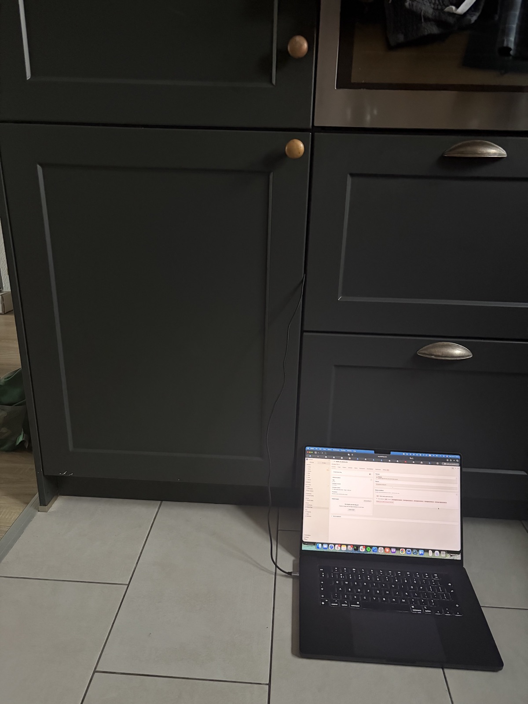
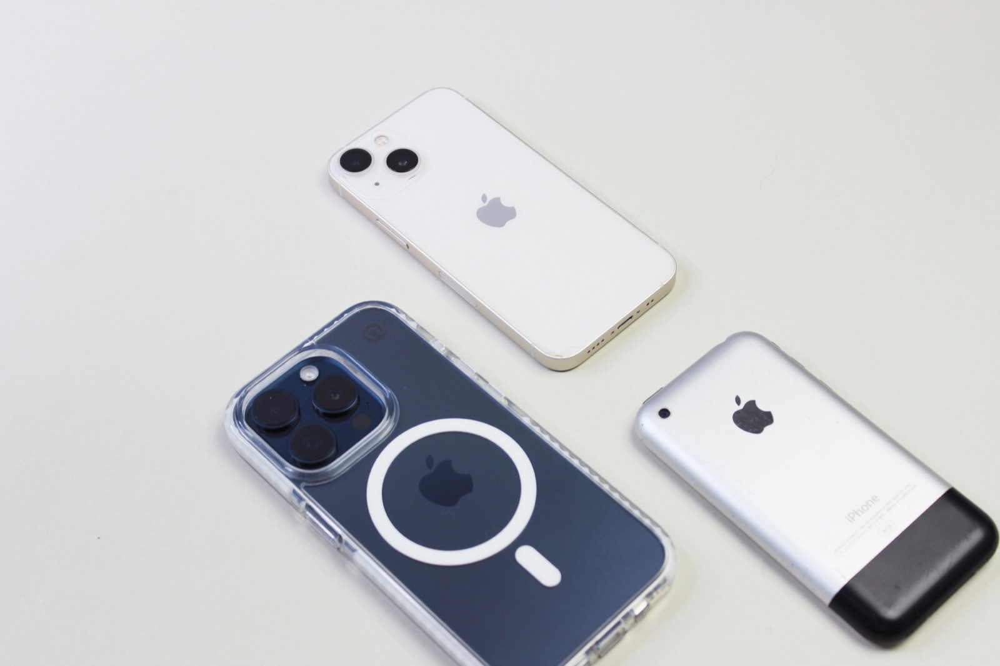

At next.app devCon Swift 2026 in Berlin I gave a talk about on-device AI: what it is, what runs today, what breaks, and where it goes. This post is the written version of that talk.

Recording: [Watch on YouTube](https://www.youtube.com/watch?v=hxQZqrG2JEA)

<iframe src="https://www.youtube.com/embed/hxQZqrG2JEA" title="Think Local: Magic at Your Fingertips" style={{ width: '100%', aspectRatio: '16 / 9', border: 0 }} allow="accelerometer; autoplay; clipboard-write; encrypted-media; gyroscope; picture-in-picture" allowFullScreen></iframe>

I've been building iOS apps since 2009, when the SDK first came out: Readdle, Wire, CaraCare, Feeld, and now ElevenLabs, where I work on the mobile team on [ElevenReader](https://elevenreader.io). Over the past months a big part of my work has been getting our text-to-speech models to run on the phone, with no network at all. Everything below comes from that work. Opinions are my own.

## How a model runs on a phone

Before talking about where this is going, let's look at how it works today. What is the model we're running? Why does it need compiling? Why does Apple's stack behave differently from everyone else's?

I won't teach you machine learning here. The goal is a mental model good enough that when someone throws words like quantization, NPU or fp16 at you, you know roughly what they mean.

### A model is a function

```swift
func model(input: [Float]) -> [Float] {
    // billions of multiplications later
    return output
}
```

A machine learning model takes an array of numbers in and returns an array of numbers out.

For text-to-speech, the input encodes the text and the output encodes a waveform. For an image classifier, the input is pixels and the output is "this is 73% a cat."

All the intelligence of the model lives in the numbers it uses to turn input into output. Those numbers are called **weights**.

### Vectors and matrices

Twenty seconds of maths, for anyone who last saw this in school. A **vector** is an ordered list of numbers. A **matrix** is a grid of numbers laid out in rows and columns. The weights of a model live in matrices.

The core operation inside every ML model is multiplying a vector by a matrix to get a new vector, and then doing it a few billion more times. One row of the weight matrix, multiplied with the input vector, gives one cell of the output. Repeat for each row and you have one layer:

<iframe src="/images/think-local/anim/matmul.html" title="Matrix multiplication" style={{ width: '100%', aspectRatio: '16 / 9', border: 0 }} loading="lazy"></iframe>

A modern model does billions of these every second.

### Weights are the model

When we say "ship the model to the device," we mean shipping a file with billions of numbers in it, in a specific layout. Depending on the model and its precision, that file weighs anything from a couple of hundred megabytes to several gigabytes.

The numbers can be stored as floats (fp32, fp16, bf16) or as integers (int8, int4). 32-bit floats are accurate and huge. Half precision cuts the size in half, usually with no audible or visible quality loss. Quantization squeezes further, down to 8-bit integers or smaller: a much smaller file, much faster, usually with some quality cost.

A model that weighs 2 GB in fp32 might be 500 MB in fp16 and 150 MB quantized. Often that's the difference between "this fits in your app" and "this doesn't."

In the animation below, the grey grids are weights. They load once at the start of a session and stay in memory. The red pulses are **activations**, the data flowing through the network on each inference. New data goes in and new data comes out, while the weights stay the same the whole time.

<iframe src="/images/think-local/anim/weights-vs-activations.html" title="Weights versus activations" style={{ width: '100%', aspectRatio: '16 / 9', border: 0 }} loading="lazy"></iframe>

Loading weights is a one-time cost. Running activations through them happens every time a user asks for something.

### Hardware does the math

A modern phone has three places where this math can happen.

- **CPU.** General purpose. SIMD instructions (NEON on every ARM chip, AMX on recent Apple chips) do many multiplications per cycle.
- **GPU.** Thousands of small cores multiplying in parallel. Great for big tensor operations. Metal on Apple, Vulkan on Android.
- **NPU.** Purpose-built silicon for ML operations. Apple calls theirs the Neural Engine (ANE). Qualcomm has Hexagon, Samsung has ENN, Google has the Tensor Edge TPU. Each one has its own instruction set.

The NPU is the fastest and the most energy-efficient, and also the most constrained. It only accepts certain operation shapes. If your model has a layer the NPU can't run, the runtime falls back to the GPU or CPU.

Here is the same matrix operation on each of the three. The CPU takes the longest and uses the most power, the GPU is faster and uses less, and the NPU is fastest and uses the least.

<iframe src="/images/think-local/anim/hardware-compare.html" title="CPU, GPU and NPU compared" style={{ width: '100%', aspectRatio: '16 / 9', border: 0 }} loading="lazy"></iframe>

### Compilation makes the model fit the hardware

The model file you ship is in a portable format, such as ONNX or a Core ML package: the same bytes on every iPhone. The operations inside it still have to become real GPU shaders or ANE instructions for the chip in the user's hand. That translation is compilation.

It happens the first time the model loads on a device. For a small model on a recent iPhone it takes a few seconds. For a big pipeline on an older phone it can take minutes. The result is cached per device and per OS version, so later launches skip it. This is why on-device models often show a "preparing" moment on first use.

Now multiply that by every platform you ship on. One source model turns into four target formats for four kinds of silicon. Each conversion takes real work, and each target has its own operation coverage, its own quantization support and its own debugging tools:

<iframe src="/images/think-local/anim/fragmentation.html" title="One model, many targets" style={{ width: '100%', aspectRatio: '16 / 9', border: 0 }} loading="lazy"></iframe>

## Lessons from shipping on-device TTS

These come from getting our TTS models running in ElevenReader.

### Lesson 1: Dispatch is a hint

On iOS you set `computeUnits` to `.cpuAndNeuralEngine`. What you're doing is offering the system a budget. It runs its own cost model and decides where the work actually runs, so you can ask for the NPU and get the CPU. On iPhone 15 we repeatedly saw Core ML's CPU int8 path beat the Core AI GPU path for our workload. Eight years of hand-tuned NEON and AMX kernels is a hard baseline to beat.

Android does the same thing. You hand a graph to the NPU delegate and it silently falls back to the CPU for operations the NPU doesn't support.

Whether your model actually ran on the NPU is something you find out with Instruments or Perfetto. There is no code API for it. There is also no tool today that explains *why* the NPU wasn't picked, and I'd like Apple to build one.

### Lesson 2: NPUs demand static shapes

NPUs plan memory and shaders at compile time. Dynamic shapes feel harmless in Python, but on the device every new input shape means a recompile on every call. On an A16 that takes five to twenty seconds. Qualcomm's QNN compiler refuses dynamic shapes outright.

There's a second cost. The Apple GPU has a hard limit of 32 Metal residency sets, one per unique shape. Hit 33 and things start getting evicted. On Android, every shape ships as a separate compiled artifact in the APK.

The fix is the same on both platforms: pad inputs to a few fixed bucket sizes and compile one artifact per size. You waste some compute on padding, and it's still the right call.

Both rows below run ten inferences. The top one uses a static shape: it compiles once and every inference after that is cheap. The bottom one uses dynamic shapes, so every new input triggers a recompile. Static finishes while dynamic is still working.

<iframe src="/images/think-local/anim/static-vs-dynamic.html" title="Static versus dynamic shapes" style={{ width: '100%', aspectRatio: '16 / 9', border: 0 }} loading="lazy"></iframe>

### Lesson 3: The first compile is a UX event

For a simple classifier, the first compile is quick. For a serious multi-stage pipeline, it can take a long time. On iPhone 17 Pro one of our pipelines took about sixty seconds. On iPhone 15, several minutes. Older devices are worse.

The cache saves you on later launches. For the first one, you need UI: show a "preparing" state and design it as part of the product.

The long-term fix is compiling ahead of time, during the app build on CI. Apple ships `xcrun coreai-build compile` for this. On Android, QNN forces you onto the ahead-of-time path anyway. We're moving that way on iOS too.

### Lesson 4: Peak memory kills more models than latency

iPhone 15 has 6 GB of RAM. Our hybrid pipeline plus a fallback peaks at about 1.4 GB during setup. One variant hit a 3 GB watermark while the model was being specialized for the device and got killed, so we dropped it.

On devices with 4.5 GB of RAM or less, we route some sub-models to the CPU only, to keep the NPU's memory footprint bounded. That costs latency and saves memory.

We listen for memory warnings, and we still don't unload the model mid-session, because reloading it costs more than living with the pressure.

### Lesson 5: Three things that silently cost you 30%

- **Debug builds.** Release is about 1.3× faster for inference. Always benchmark Release, or you'll chase regressions that don't exist.
- **File I/O in the hot path.** Even logging hurts. We had 39 diagnostic file writes per synthesis, and they cost us 30% of throughput. Removing them gave it back.
- **Leftover diagnostic loops.** I added a `minV/maxV/meanV` loop over the output tensor as a sanity check and forgot about it. It made inference 2× slower for a week.

All three are embarrassing, and I've seen every one of them on other teams too.

### Lesson 6: The phone gets hot

You benchmark at your desk, the phone is cool, the numbers look great. A user runs the same thing for two minutes with the phone in a warm pocket, and latency doubles. Apple silicon and Qualcomm both throttle hard once skin temperature passes roughly 40 °C. The NPU is often the first to slow down, because fixed-function silicon runs hot per square millimetre.

Our rule: always profile after at least sixty seconds of sustained load, and write down the device temperature next to the result. A benchmark without a temperature reading is a marketing claim.



## iOS specifics

Three things that only apply to Apple platforms.

### Core ML and Core AI

Core ML has been Apple's ML runtime since iOS 11, with models in the `.mlpackage` format. It's mature, well understood and fast, and it's still the default for most things.

Core AI arrived with iOS 27 at WWDC, with a new `.aimodel` format. It's built for LLM-scale models, with palettization and better memory control, and over time it will take over the heavy workloads from Core ML. You'll also hear about MLX, Apple's PyTorch-like array framework. It's research-first and ships on the Mac.

If you support iOS 17 through 27, you need both runtimes. Fence the Core AI code with `#if canImport(CoreAI)` and `@available(iOS 27, *)`. Expect the Swift API to change between betas and point releases: in our case `NDArray.MutableView.baseAddress` turned into `withUnsafeMutablePointer`, and `AsyncValue.ndArray` became `try await`. Build against the latest Xcode.

### Model protection

On protecting your model, Apple gives you more than Android does: FairPlay encryption for Core ML models, App Attest and the Secure Enclave. I cover them in the security section below, because they only make sense next to the threat model.

### Swift concurrency around ML

```swift
@MainActor @Observable
final class TTSManager { ... }

nonisolated func synthesize(_ text: String) async throws -> AudioStream
```

The manager is `@MainActor @Observable`, so the UI can bind to it. Inference is `nonisolated async throws` and runs off the main actor. The inner engine is `@unchecked Sendable`: its configuration is written once at init and only read during inference.

Cancellation is the weak spot. `MLModel`'s `prediction` call takes no cancellation token. If you need to cancel mid-synthesis, split the pipeline into chunks you can cancel between, and plan for this from the start.

### A note on Android

I also gave an Android version of this talk. The lessons above apply there too. The Android-only surprises:

- **Runtime.** We train in PyTorch, so we use ExecuTorch, PyTorch's own on-device runtime. Every conversion from one format to another is a chance to lose an operation, precision or speed, so pick the runtime closest to where your model already lives.
- **Packaging.** On iOS, the system compiles the model for the chip at first launch. On Android's fastest NPU path, that compilation happens on a build server before you ship, and the output is tied to a chip family. You compile once per chip family, bundle all of them in the APK (or download the right one), and pick the matching one at launch. A new flagship chip means a new entry in your build pipeline.
- **Native libraries.** Vendor native libraries have to ship uncompressed in the APK. Stripping their debug symbols makes them refuse to load. A couple of environment variables have to be set from Kotlin before the first native call. And NDK and CMake updates break the native build often enough that you should pin exact versions. My colleague Franek did this integration and hit every one of these before the first inference ran.

## Where this is going

That covers where things stand today. To explain why I think on-device AI matters, I'll start with two short stories from history.

### Time


We complain about not having enough time. People in the past had a worse problem: they couldn't tell what time it was.

Picture a medieval European town. The biggest building has a huge clock on it. Bells ring at certain hours. Someone walks door to door to wake people up. Time was infrastructure. You looked up at the tower, and if you couldn't see it, you didn't know. Peasant, merchant or scholar, none of them had a way to know the exact time privately.


John Harrison spent forty years building a chronometer that worked at sea. A century later, wristwatches were cheap enough for everyone.

If you'd asked a medieval peasant to imagine the future of time, they would have described a bigger clock tower, maybe one with lights. A personal watch in your pocket would never have crossed their mind. The central source was all they knew.

### Computers


In the 1970s my mother wrote her university assignments on punch cards. She walked to the university basement, handed the cards to an operator, and the job ran overnight. She came back the next day, sometimes to find a single wrong letter.

Computing lived in a room, and you went to visit it, the same way people went to look at the town clock.



Then it moved: first onto desks, then into pockets. I started building for the iPhone in 2009.

When Steve Jobs held up that phone in 2007, nobody in the room predicted a billion-dollar photo filter app, or summoning a stranger's car, or chat apps replacing SMS. Those products appeared because the technology moved to the person. Social habits changed too. Waiting by the landline for a call you couldn't miss means nothing to anyone under twenty-five.

### Each wave comes faster

Clocks took four hundred years to become personal. Computers took about twenty, and mobile about fifteen. Every time, we underestimated what people would do with a capability once it became personal and private.

### We rent thinking by the token

Today, if you want to think with AI, you send your data to someone else's building and pay for the round trip by the token. Your users' voices, your customers' medical records and your own ideas all go to a data center in Virginia or Oregon.

I believe this is the last decade we'll work like that. Soon "wait, you had to send your data to a server?" will sound as old-fashioned as "wait, you had to be home to receive a phone call?"

Physics, economics and privacy all push in the same direction. Four things have to come together.

**Compute** doubles about every two years. The dual-NPU iPhone 18 Pro roughly doubles the A19, and Snapdragon is on the same curve.

<iframe src="/images/think-local/anim/path-to-gpt4.html#1" title="Compute growth" style={{ width: '100%', aspectRatio: '16 / 9', border: 0 }} loading="lazy"></iframe>

**Memory bandwidth** is the harder constraint for LLM inference. It jumped 70% on Apple in one generation, with Snapdragon close behind.

<iframe src="/images/think-local/anim/path-to-gpt4.html#2" title="Memory bandwidth growth" style={{ width: '100%', aspectRatio: '16 / 9', border: 0 }} loading="lazy"></iframe>

**Software** improves through five model-side techniques that stack on top of each other:

- Int4 quantization: four times smaller
- Mixture of experts: roughly seven times the effective capacity
- Partial loading from flash: the model streams in on demand
- Distillation: small models trained on the outputs of big ones
- Sparsity: zero out weights and skip them

Combined, that's ten to fifty times the effective capacity on the same hardware.

<iframe src="/images/think-local/anim/path-to-gpt4.html#3" title="Software techniques" style={{ width: '100%', aspectRatio: '16 / 9', border: 0 }} loading="lazy"></iframe>

**Put together**, these make GPT-4-class inference on a flagship phone in airplane mode look like a 2028 problem. iOS and Android will get there within months of each other.

<iframe src="/images/think-local/anim/path-to-gpt4.html#4" title="GPT-4 class on device" style={{ width: '100%', aspectRatio: '16 / 9', border: 0 }} loading="lazy"></iframe>

## Security is the real blocker

Six months ago I thought performance was the hard problem. Now I think performance is a solvable engineering problem, and the hard one is protecting the model from the device it runs on.

A trained model represents a large amount of money in compute, proprietary data and years of research. For a company whose advantage is its model, losing control of the file is existential. For an open-source model, it doesn't matter at all.

### What an attacker can do

- Pull the model file out of app storage over USB or ADB
- Hook the inference call with Frida or LLDB
- Dump the decrypted weights from process memory
- Run or clone the model on their own hardware

If I ship my weights to your device, I've effectively given them to you. The license terms don't help once the bits are inside your sandbox. Encryption at rest doesn't help either, because the model has to be decrypted to run, and the decrypted copy sits in RAM for as long as inference runs.

### Tools that raise the cost

- **RASP** (Runtime Application Self-Protection): anti-debugging, anti-hooking and integrity checks, from vendors such as Promon, Guardsquare and Jscrambler. A determined attacker still gets through, but it costs them time and money.
- **App Attest**: attests your binary and device identity to your server, so you can refuse to hand a model key to a jailbroken or modified client.
- **FairPlay for Core ML**: Apple's model encryption. Keys come through Apple's licensing infrastructure, and decryption is built into the Core ML load path, so your code doesn't deal with it.
- **Secure Enclave**: a hardware key store with kilobytes of memory. Big enough for a key that unwraps your model key, nowhere near big enough for the model itself.

On iOS these combine into the most mature on-device model protection on any mobile platform today.

### What is still missing

Even with all of the above, there's a moment during inference when the decrypted weights sit in GPU or NPU memory, and a root-level process on a jailbroken device can read that memory. Closing that gap would need:

- A trusted execution environment that developers can use and that's big enough to hold a model
- Hardware encryption of the accelerator's memory that keeps out a root-level reader
- Attested execution that ties the model hash, program hash and device identity to a key released by a third party

None of that exists today in a form developers can use. That's why ElevenLabs, OpenAI, Anthropic, Google and Meta all keep their best models in the cloud, even though phones could already run many of them.

## Open models change the math

You don't need your own model on the device to build a great product. Hundreds of production-quality open models exist: Llama, Mistral, Whisper for speech-to-text, Qwen, Gemma. The Chinese labs release new ones every month. They're all safe to ship, because the weights are already public. The value then sits in what you build around the model: the UX, the data layer, the agent logic, and the integration with the rest of the user's device.

I also think models are turning into a commodity. You can swap one frontier model for another and most apps barely notice. Recently I moved my daily coding workflow from Opus to Grok 4.6 fast and hardly felt the difference. Three years ago we all talked to GPT-3.5 directly, through a text box, and soon nobody will. A model can only get so smart if its training data doesn't get smarter, and with internet-scale text we're getting close to that ceiling.

ElevenReader is a good example. It uses ElevenLabs TTS, and in principle you could swap that for Kokoro, Piper or whatever comes out next month. What makes the app is the reading experience: the library, the voice selection, how it handles long-form content.

## Where to start

Four entry points, from easiest to hardest:

1. **If you've never shipped a model:** open Foundation Models in iOS 26. One `LanguageModelSession`, text in, text out. Thirty minutes.
2. **If you want your own weights:** try MLX Swift with a small open model like SmolLM or Qwen 0.5B. Native Swift, Mac first.
3. **If you want to go deep:** convert a PyTorch model with CoreAI-Torch, ship an `.aimodel`, and watch the first compile in Instruments.
4. **If you want to understand IP protection:** read Apple's App Attest docs, then try to extract a model from your own app. It's humbling.

I ended the talk on a slide that said *this page is intentionally left blank*. Nobody in 2007 knew which apps the iPhone would make possible, and today nobody knows which products will come from models running on the phone. Mobile developers are in a good position to find out first.

If you'd like to work on this, we're hiring at [ElevenLabs](https://elevenlabs.io/careers).

<small>Some images are AI-generated. Thanks to Unsplash users Sophia Stark and Enrico Bet.</small>
