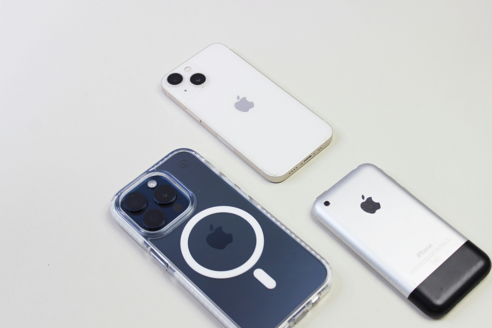

<!--
Think Local · Builders & Brews Berlin · 5 minutes
Slide plan:
  1  Cover (wave hero)
  2  ElevenLabs (headline + body)
  3  Before: sailors got lost
  4  After: everyone's wrist
  5  Before: mother's punch cards
  6  After: father's landline / your iPhone
  7  The pattern
  8  Right now (cloud → device)
  9  Blank page
  10 Close
-->

<!-- _class: cover -->
<!-- _paginate: false -->

# Think Local

<h2>Michael Gerasymenko </h2>
Builders &amp; Brews · Berlin · 2026

<!--
Hey builders. My name is Michael Gerasymenko. Incredibly happy to speak here today!

I have only five minutes here, so will go fast. If you have any questions afterwards, catch me afterwards or connect on LinkedIn. 

I've been building mobile apps since 2009, so you might see where are all the historical references would be coming from.

I think you might have heared about the company where I work:...
-->

---

ELEVENLABS / CONTEXT

# ElevenLabs

- The Voice AI · over $600M ARR · valued at $22B
- I started here six months ago, company went from 400 to 800 people
- I'm on the Mobile team, working on ElevenReader
- We are hiring, also remote
- Opinions are my own

<!--
ElevenLabs! It is a voice AI company. Since I've started here six months ago, we doubled the headcount. This means, we are hiring. Many internal products are run like startups, so reach out with your ideas as well.

For this presentation, I must share a waiver: Opinions are my own, so don't see it as a company position, but as my own one.

I'm working on the ElevenReader product, which is simply aweseome, I recommend checking it out. If you catch me afterwards I can add you on an annual subscription, but in that case you must share with me the bug reports. IF you find any!

But first, there were some news I must share:

-->

---
<!-- _class: chapter -->

# ElevenLabs TTS V4

https://elevenlabs.io/v4 

live on 28th of September

<!--

I think it would be fair to say that the TTS is one of the foundational blocks of ElevenLabs, and we have a new version to share. Luckily, I don't have to talk, as it would be presenting itself -Play-

-->

---

<!-- _class: chapter -->

Chapter I

# Time

<!--

It's ironic that I have only five minutes to talk about time, even less now, but here we are. I promise to be on time!
-->

---

<!-- _class: story -->

BEFORE / Chapter I

# Precise time

<!--

We frequently have not enough time, but in the past people had a trouble with time that was even worse. 

If you think about a tall medieval city building, you've probably noticed that people tend to put huge clocks on them. Or bells ringing at the specifc times throughout the day. There were even people going door to door to wake people up. This was done to a big extent out of necessity. 

Problem was, they could not determine the exact current time. Until people invented precise home and then pocket watch, only reliable way to count time was to use the sun height above the horizon in a combination with the local observations or local geographical coordinates.

A medieval dweller was unable to determine exact time without those huge clocks or bells.

-->

---
<!-- _class: story -->

BEFORE / Chapter I

# Sailors got lost at sea

<!--

In 1714, the British Empire was losing ships — not to storms, not to enemies, but because sailors literally can't tell where they are.

To know your longitude at sea, you need to know the exact time back at your home port. And no clock existed that could survive an ocean voyage.

So Parliament offers £20,000 — millions today — to anyone who can build one.

-->

---

<!-- _class: story -->

AFTER / Chapter I

# Time moved onto your wrist

<!--

So why I am telling you about all this? If you are going to put yourself in the shoes of a medieval person, a peasant or an inventor, they would never in their live imagine having a source of a precise time.

The centralized time source is what they knew. They might have anticipated the coming of better tower clocks, may be with a highlighted face, or having more of them. But never in their live they anticipated having a personal pocket watch.

-->

---

<!-- _class: chapter -->

Chapter II

# Computer Time

<!-- 

Luckily, we have more time here. So let's continue

-->

---

<!-- _class: story -->

BEFORE / Chapter II

# You walked to the computer

<!--
My mother, in the 1970s, wrote her university assignments on punch cards, then she walked to the university building's cellar, handed them to an operator. Then, the task was executed on the machine during the night. She came back the next day to pick up a printout, sometimes just to find one letter bug in the punch card.

Computing lived in a room. You visited it. Same shape as the town clock.

Some visionaries at the time across the ocean were already imaginigng the compact computers. But I assure you those visionaries did really great later on.

-->

---

<!-- _class: story -->

AFTER / Chapter II

# The computer walked into your pocket

<!--
Then it moved. First onto desks. Then into pockets. I started building for iPhone in 2009.

When Steve Jobs held up the phone in 2007, nobody in that room said "the killer app will be a photo-filter service." Nobody said "we'll summon strangers' cars." Nobody said "we'll replace SMS with a chat app."

Those products appeared because the technology moved to the person. And whole social patterns died — waiting by the landline for a call you couldn't miss is a genre that has evaporated.

-->

---

<!-- _class: chapter -->

Chapter III

# Next Revolution

---

<!-- _class: big -->

THE PATTERN

<h1>It happens again.   It happens faster.</h1>

<!--
400 years · 50 years · 20 years · 15 years · ?
400 years for clocks. 50 years for factory power. 20 years for computers. 15 for mobile.
Every wave, faster. Every wave, we underestimated what people would do with the capability once it became not centralized but personal and private.

-->

---

<!-- _class: now -->

RIGHT NOW

# We rent thinking by the token

Today, if you want to think with AI, you send your data to someone else's building and pay for the round trip.

<strong>This is the last decade you'll do that.</strong>

<!--
Which brings us to right now. If you want to think with AI, you send your prompt to a data center owned by someone else, and you pay for the round trip by the token. Your ideas, your users' voices, your customers' medical records — they all go on a trip.

Soon, "wait, you had to send your data to a server?" will sound as antique as "wait, you had to be home to receive a phone call?"

The technology will move. Physics, economics, privacy — all three point the same way. That part is not my prediction. It's inevitable.
-->

---

<!-- _class: blank -->
<!-- _paginate: false -->

THIS PAGE IS INTENTIONALLY LEFT BLANK

<!--
[Pause. Let the silence sit for a beat.]

What is not inevitable is what you build with it. Nobody predicted Spotify from watching a musician play in a Victorian parlor. Nobody predicted Instagram from an iPhone announcement.
The product is a blank page. Your job — as builders in this room, today — is to be the person who creates what goes on it.
-->

---

<!-- _class: close -->

#

 
 
 
 

## Thank you!

We're hiring people who want to figure out what  happens next.

elevenlabs.io/careers · come say hi

 
 

Some images AI-generated. Thanks to Unsplash users Sophia Stark and Enrico Bet

<!--
The clock is coming.
If any of this made you think about tomorrow instead of today — we're hiring people who want to figure out what happens next.
Find me at the coffee. Thanks Berlin.
-->
