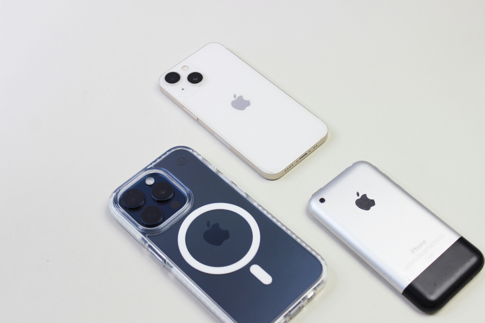

<!--
Think Local: Magic at your fingertips · KotlinLeeds · 30 minutes
Michael has NEVER worked on Android professionally. Position as an iOS engineer who
researched on-device inference on Android. Honest about what he hasn't tried.

Slide plan:
  1   Cover
  2-4 Intro (I'm an iOS engineer, honest)
  5-11 Historical inspiration (trimmed)
  12  Chapter II: Under the hood
  13-18 ML fundamentals (trimmed)
  19  Chapter III: Android
  20-26 Android deep dive, from research, not shipping
  27  Chapter IV: The frontier
  28-29 Security close
  30  Blank page
  31  Thank you
-->


<style>

section {
  background: #FFFFFF;
  color: #111111;
  font-family: "Roboto", -apple-system, "Helvetica Neue", Arial, sans-serif;
  font-size: 28px;
  line-height: 1.4;
  padding: 60px 60px 100px 60px;
  position: relative;
}

h1 { font-size: 66px; line-height: 1.05; font-weight: 800; letter-spacing: -1px; margin: 0 0 24px 0; color: #111111; }
h2 { font-size: 34px; line-height: 1.2; font-weight: 700; margin: 0 0 16px 0; color: #111111; }
h3 { font-size: 24px; line-height: 1.3; font-weight: 700; margin: 0 0 8px 0; color: #111111; letter-spacing: 0.5px; text-transform: uppercase; }

p { margin: 14px 0 0 0; color: #333333; max-width: 30ch; }
strong { font-weight: 700; color: #000000; }
em { font-style: italic; color: #555555; }

code {
  font-family: "JetBrains Mono", "Menlo", monospace;
  font-size: 0.85em;
  background: #F2F2F2;
  padding: 2px 8px;
  border-radius: 4px;
  color: #111;
}

pre {
  background: #F2F2F2;
  padding: 20px;
  border-radius: 8px;
  font-size: 20px;
  line-height: 1.4;
  overflow-x: auto;
}

pre code { background: transparent; padding: 0; }

section::before {
  content: "";
  position: absolute;
  left: 60px;
  bottom: 34px;
  font-weight: 800;
  font-size: 20px;
  letter-spacing: -0.5px;
  color: #111111;
  z-index: 10;
}

section.cover::before,
section.company::before,
section.close::before {
  content: "IIElevenLabs";
}

header, footer {
  color: #9A9A9A;
  font-size: 12px;
  font-weight: 700;
  letter-spacing: 1.5px;
  text-align: center;
  width: 100%;
  bottom: 40px;
}

section::after {
  color: #9A9A9A;
  font-size: 14px;
  font-weight: 500;
  right: 60px;
  bottom: 34px;
}

.label {
  position: absolute;
  top: 40px;
  left: 60px;
  font-size: 13px;
  font-weight: 700;
  letter-spacing: 1.8px;
  color: #9A9A9A;
  text-transform: uppercase;
}

section.cover {
  padding: 60px 60px;
  background-image: url('assets/waves/image7.jpg');
  background-repeat: no-repeat;
  background-position: center 55%;
  background-size: 110% auto;
}

section.cover h1 {
  font-size: 130px;
  line-height: 0.95;
  letter-spacing: -3px;
  margin-top: 0;
  max-width: 12ch;
  position: relative;
  z-index: 2;
}

section.cover .subtitle {
  position: absolute;
  left: 60px;
  bottom: 90px;
  font-size: 18px;
  color: #555555;
  font-weight: 500;
  line-height: 1.5;
  max-width: none;
  z-index: 2;
}

section.cover::before { color: #111111; font-size: 24px; z-index: 3; }

section.story { padding: 60px 60px 100px 60px; }

section.story .kicker {
  position: absolute;
  top: 40px;
  left: 60px;
  font-size: 13px;
  font-weight: 800;
  letter-spacing: 2px;
  color: #9A9A9A;
  text-transform: uppercase;
}

section.story h1 { margin-top: 60px; font-size: 58px; max-width: 15ch; }
section.story .body { margin-top: 20px; font-size: 22px; line-height: 1.5; color: #333333; max-width: 42ch; }
section.story .art {
  position: absolute;
  right: 0;
  top: 0;
  width: 42%;
  height: 100%;
  object-fit: cover;
  object-position: center;
}

section.big { padding: 80px 60px 120px 60px; }
section.big h1 { font-size: 96px; line-height: 1.05; letter-spacing: -2px; margin-top: 25vh; max-width: 100%; }
section.big .sub { font-size: 22px; color: #666; margin-top: 40px; font-weight: 500; letter-spacing: 3px; text-transform: uppercase; }

section.now {
  background-image: url('assets/waves/image3.jpg');
  background-repeat: no-repeat;
  background-position: center bottom;
  background-size: 100% 45%;
}

section.now h1 { font-size: 62px; max-width: 14ch; margin-top: 40px; position: relative; z-index: 2; }
section.now .body { margin-top: 24px; font-size: 22px; line-height: 1.5; max-width: 40ch; position: relative; z-index: 2; }

section.chapter {
  display: flex;
  flex-direction: column;
  justify-content: center;
  padding: 60px 60px 100px 60px;
}

section.chapter .num {
  font-size: 16px;
  font-weight: 800;
  letter-spacing: 3px;
  text-transform: uppercase;
  color: #9A9A9A;
  margin: 0 0 12px 0;
}

section.chapter h1 { font-size: 140px; line-height: 1; letter-spacing: -3px; margin: 0; color: #111111; }

section.blank { background: #FFFFFF; }
section.blank::before, section.blank::after { content: ""; }

section.blank .caption {
  position: absolute;
  left: 0;
  right: 0;
  bottom: 40px;
  text-align: center;
  color: #B8B8B8;
  font-size: 13px;
  font-weight: 500;
  letter-spacing: 1.5px;
}

section.close h1 {
  font-size: 88px;
  line-height: 1.02;
  letter-spacing: -2px;
  margin-top: 30vh;
  max-width: 16ch;
}

section.close .cta { margin-top: 30px; font-size: 22px; color: #333; max-width: none; }
section.close .link { margin-top: 8px; font-size: 20px; font-weight: 700; color: #111; }

section.close {
  background-image: url('assets/waves/image4.jpg');
  background-repeat: no-repeat;
  background-position: center top;
  background-size: 100% 45%;
  padding-top: 48vh;
}

section.close h2 {
  font-size: 64px;
  line-height: 1.05;
  letter-spacing: -1.5px;
  color: #111;
  margin: 0 0 16px 0;
}

section.close > * { position: relative; z-index: 2; }

section.cover header, section.cover footer { display: none !important; }
section.blank header, section.blank footer { display: none !important; }

.footnotes { font-size: 12px; color: #999; margin-top: 40px; }

section.close .footnotes {
  position: absolute;
  left: 220px;
  right: 220px;
  bottom: 34px;
  margin: 0;
  text-align: center;
  font-size: 11px;
  line-height: 1.4;
}

.two-col {
  display: grid;
  grid-template-columns: 1fr 1fr;
  gap: 40px;
  margin-top: 30px;
}

.two-col > div h3 { color: #111; }
.two-col p { font-size: 20px; max-width: none; margin-top: 8px; }

section.demo {
  display: flex;
  flex-direction: column;
  justify-content: center;
  padding: 60px 60px 100px 60px;
  background: #050505;
  color: #FFFFFF;
}

section.demo::before, section.demo::after { content: ""; }
section.demo header, section.demo footer { display: none !important; }

section.demo h1 {
  font-size: 180px;
  line-height: 0.95;
  letter-spacing: -4px;
  margin: 0 0 32px 0;
  color: #FFFFFF;
}

section.demo .cue {
  font-size: 22px;
  color: #AAA;
  letter-spacing: 2px;
  text-transform: uppercase;
  font-weight: 700;
  margin-top: 24px;
}

section.demo .hints {
  position: absolute;
  bottom: 60px;
  right: 60px;
  text-align: right;
  font-size: 16px;
  color: #666;
  letter-spacing: 1px;
  line-height: 1.6;
}

section.demo .credit {
  margin-top: 24px;
  font-size: 16px;
  color: #777;
  letter-spacing: 1px;
  font-weight: 500;
  line-height: 1.5;
}

section.demo .credit strong {
  color: #BBB;
  font-weight: 700;
}

section.anim {
  padding: 0;
  background: #FFFFFF;
  overflow: hidden;
}

section.anim iframe {
  width: 100%;
  height: 100%;
  border: 0;
  display: block;
}

section.anim::before, section.anim::after { content: ""; }
section.anim header, section.anim footer { display: none !important; }

</style>

<script>
// Marp bridge: when a slide becomes active (bespoke-marp-active), postMessage
// to every iframe inside it so iframe animations can reset and replay.
// Needed because file:// iframes are cross-origin to the parent, so iframes
// can't observe parent slide classes directly.
(function(){
  if (window.__marpSlideBridge) return;
  window.__marpSlideBridge = true;
  function wire() {
    var slides = document.querySelectorAll('svg.bespoke-marp-slide');
    if (!slides.length) { setTimeout(wire, 150); return; }
    slides.forEach(function(slide){
      if (slide.__wired) return;
      slide.__wired = true;
      function broadcast() {
        slide.querySelectorAll('iframe').forEach(function(f){
          try { f.contentWindow.postMessage('bespoke:active', '*'); } catch(e) {}
        });
      }
      new MutationObserver(function(){
        if (slide.classList.contains('bespoke-marp-active')) broadcast();
      }).observe(slide, { attributes: true, attributeFilter: ['class'] });
      if (slide.classList.contains('bespoke-marp-active')) broadcast();
    });
  }
  if (document.readyState === 'loading') {
    document.addEventListener('DOMContentLoaded', wire);
  } else {
    wire();
  }
})();
</script>

<!-- _class: cover -->
<!-- _paginate: false -->

# Think Local

<div class="subtitle">
Magic at your fingertips<br>
Michael Gerasymenko · ElevenLabs<br>
KotlinLeeds · 2026
</div>

<!--
Hey Leeds. My name is Michael Gerasymenko. Thanks for having me.

Honest disclaimer before I start. I am an iOS engineer. I have never shipped an Android app. What I have done over the last seven months is research on-device inference on Android, because our team cares about both platforms and someone had to look.

Think of this as an outsider mapping your territory. I'll share the lay of the land as I found it. If you catch something I got wrong, I want to hear it.
-->

---

# Who am I

- Building mobile apps since **2009**
- Readdle, Wire, CaraCare, Feeld, now ElevenLabs
- OSS tools author (`github.com/mikeger`)
- On the Mobile team at ElevenLabs, working on **ElevenReader**
- Originally from **Ukraine**, living and working in **Berlin**
- This year I've started researching **on-device inference**

<!--
Mobile since 2009. iOS the whole way. Readdle, Wire, CaraCare, Feeld, now ElevenLabs. Also built an open-source test optimisation tool.

Originally from Ukraine, based in Berlin for a few years now. Travelled over to Leeds for this one.

Six months ago at ElevenLabs I started looking at on-device inference. We care about both platforms. I built a research Android app from scratch, probably the first Android app I have ever committed to a repo, to understand the landscape.

So. I spent seven months looking at the on-device ML stack on your platform. That is why I'm standing here. Jetpack Compose expertise is not what I bring.
-->

---

<!-- _class: company -->

<div class="label">ELEVENLABS / CONTEXT</div>

# IIElevenLabs

- The Voice AI
- Started here seven months ago, company went 400 → 800 people
- I'm on the Mobile team, working on **ElevenReader**
- Mobile team is hiring, also remote (currently, ElevenMusic 🎵 )
- *Opinions are my own*

<!--
Where I work. ElevenLabs, the voice AI company. Over 600 million ARR. Reportedly valued at twenty-two billion. Joined seven months ago and headcount doubled in that time.

I work on ElevenReader. That's where the research team's work ships. Catch me after and I can set you up with a free annual subscription. Small catch: tell me about any bugs.

Mobile team hires both iOS and Android. If what I say today interests you, come find me after.

Opinions here are my own.
-->

---

<!-- _class: chapter -->

<div class="num">Part One</div>

# Under the Hood

<!--
Before we talk about where this is going, let me show you how it actually works today. What is a model we are running? Why does it need compiling? Why is the stack different on every platform?

Next few minutes, I will demystify it. I am not teaching you ML. Just enough mental model that the terms stop being scary.
-->

---

# A model is a function

```kotlin
fun model(input: FloatArray): FloatArray {
    // billions of multiplications later
    return output
}
```

<!--
Start here. A machine learning model is a function. Takes an array of numbers in. Returns an array of numbers out.

That is it. No magic.

TTS: input encodes text, output encodes a waveform. Image classification: input is pixels, output is "seventy-three percent a cat."

The entire intelligence is in the numbers it uses to transform input into output. Those numbers are the weights.
-->

---

<div class="label">PRIMER</div>

# Vector + matrix

<div class="primer">
<style>
.primer { display: flex; align-items: flex-start; justify-content: center; gap: 90px; margin-top: 50px; }
.primer .box { display: flex; flex-direction: column; align-items: center; }
.primer .cap { font-size: 15px; font-weight: 700; letter-spacing: 2px; color: #999; text-transform: uppercase; margin-bottom: 18px; }
.primer .vector-grid { display: grid; grid-template-columns: 70px; grid-template-rows: repeat(4, 70px); gap: 6px; }
.primer .matrix-wrap { display: grid; grid-template-columns: 36px 1fr; grid-template-rows: 36px 1fr; gap: 10px; }
.primer .matrix-grid { display: grid; grid-template-columns: repeat(4, 70px); grid-template-rows: repeat(3, 70px); gap: 6px; }
.primer .cell { display: flex; align-items: center; justify-content: center; border: 1.5px solid #BBB; border-radius: 6px; color: #333; font-size: 22px; font-weight: 500; background: #FFF; }
.primer .row-labels { display: grid; grid-template-rows: repeat(3, 70px); gap: 6px; align-items: center; font-size: 12px; font-weight: 700; color: #999; text-align: right; padding-right: 4px; letter-spacing: 1px; }
.primer .col-labels { display: grid; grid-template-columns: repeat(4, 70px); gap: 6px; justify-items: center; font-size: 12px; font-weight: 700; color: #999; letter-spacing: 1px; }
.primer .corner { }
.primer .shape { font-size: 13px; color: #AAA; margin-top: 14px; font-weight: 500; letter-spacing: 1px; }
</style>

<div class="box">
  <div class="cap">Vector</div>
  <div class="vector-grid">
    <div class="cell">x₁</div>
    <div class="cell">x₂</div>
    <div class="cell">x₃</div>
    <div class="cell">x₄</div>
  </div>
  <div class="shape">ordered list · 4 numbers</div>
</div>

<div class="box">
  <div class="cap">Matrix</div>
  <div class="matrix-wrap">
    <div class="corner"></div>
    <div class="col-labels"><span>col 1</span><span>col 2</span><span>col 3</span><span>col 4</span></div>
    <div class="row-labels"><span>row 1</span><span>row 2</span><span>row 3</span></div>
    <div class="matrix-grid">
      <div class="cell">w</div><div class="cell">w</div><div class="cell">w</div><div class="cell">w</div>
      <div class="cell">w</div><div class="cell">w</div><div class="cell">w</div><div class="cell">w</div>
      <div class="cell">w</div><div class="cell">w</div><div class="cell">w</div><div class="cell">w</div>
    </div>
  </div>
  <div class="shape">grid · 3 rows × 4 columns</div>
</div>
</div>


<!--
Twenty seconds of maths, for anyone who last saw this in school.

A vector is an ordered list of numbers. A matrix is a grid of numbers, laid out in rows and columns. The weights of a model live in matrices like this.

The operation inside every ML model: multiply a vector by a matrix, get a vector back. Then do it a few billion more times.
-->

---

<!-- _class: anim -->

<iframe src="assets/anim/matmul.html"></iframe>

<!--
One of those multiplications, visualised. One row of the weight matrix, dot-producted with the input vector, lights up one cell of the output. Repeat for each row. That is one layer. A modern model does billions of these every second.
-->

---

# Weights are the model

- Billions of numbers in a specific layout
- Stored as **floats** (fp32, fp16, bf16) or **ints** (int8, int4)
- A file. Hundreds of MB to several GB.
- *This is what you ship to the device.*

<!--
Shipping a model means shipping a file with those numbers in it.

Precisions. Thirty-two-bit floats are accurate and huge. Half-precision cuts the size in half with little quality loss. Quantization squeezes further, to eight-bit integers or smaller. Much smaller, much faster, usually some quality cost.

A model that is two gigabytes in fp32 might be five hundred megabytes in fp16, one hundred and fifty quantized. Often the difference between "fits in your app" and "does not."
-->

---

<!-- _class: anim -->

<iframe src="assets/anim/weights-vs-activations.html"></iframe>

<!--
Mental model to keep. Grey grids are the weights. They load once and stay in memory. Red pulses are activations, the data flowing through the network on each inference. New data in, new data out, same weights the whole time.

Loading weights is a one-time cost. Running activations through them is what happens every time a user asks something.
-->

---

# Hardware does the math

<div class="two-col">
<div>
<h3>CPU</h3>
<p>General-purpose. SIMD (NEON on every ARM, AMX on Apple) for parallel math.</p>
</div>
<div>
<h3>GPU</h3>
<p>Thousands of small cores. Metal on Apple, Vulkan on Android. Great for big tensors.</p>
</div>
</div>

<div class="two-col">
<div>
<h3>NPU</h3>
<p>Fixed-function silicon. Apple ANE, Qualcomm Hexagon, Samsung ENN, Google Tensor. Fastest and most efficient.</p>
</div>
<div>
<h3>The tradeoff</h3>
<p>Each tier is faster but more constrained in what it can run.</p>
</div>
</div>

<!--
Three places math can happen on a modern phone. CPU, GPU, NPU.

CPU has SIMD instructions. NEON on every ARM chip. AMX on recent Apple ones. Many multiplications per cycle. Flexible, general.

GPU has thousands of small cores that multiply in parallel. Great for big tensor operations. Metal on Apple, Vulkan on Android.

NPU is purpose-built silicon for ML ops. Apple calls theirs the Neural Engine. Qualcomm has the Hexagon DSP. Samsung has ENN. Google has their Tensor Edge TPU. Each one has its own instruction set.

Fastest and most energy-efficient. Also the most constrained. If your model has a weird layer the NPU cannot run, the runtime falls back to GPU or CPU.
-->

---

<!-- _class: anim -->

<iframe src="assets/anim/hardware-compare.html"></iframe>

<!--
Same matrix operation on each of the three. CPU takes the longest and uses the most power. GPU is faster, uses less. NPU is fastest, uses the least. The tradeoff sits on the NPU side. It only accepts certain op shapes. An unsupported layer and the graph bounces back to GPU or CPU.
-->

---

# Compilation makes the model fit the hardware

- Model file arrives in a portable format (`.tflite`, `.onnx`, `.pte`)
- Must be **compiled** for *this specific chip*
- On Android: often **ahead-of-time, per SoC**, baked into the APK
- Not "write once, run anywhere" at all

<!--
Portable formats exist. TFLite, now LiteRT. ONNX. ExecuTorch's dot pte. But those bytes have to become actual GPU shaders or NPU instructions on the chip you run on.

On iOS, Core ML compiles on-device at first launch. On Android, especially for NPUs, you often compile ahead of time per SoC and ship separate artefacts. We'll see how fast that gets ugly.
-->

---

<!-- _class: anim -->

<iframe src="assets/anim/fragmentation.html"></iframe>

<!--
One source model, four target formats, four pieces of silicon. On Android alone you cross three of these. Each conversion has its own op coverage, its own quantization story, its own debugging tools. This is what fragmentation looks like.
-->

<!--
[Play the recording. Thirty seconds. Narrate briefly what the audience is seeing.]

Snapdragon 8 Elite. Airplane mode is on. No cloud. The research app running the TTS pipeline through QNN on the Hexagon NPU. Thirty seconds of synthesis, locally.

STAGE NOTES:
- Audio out through venue PA. Test during AV check.
- Keep the recording short: thirty seconds max.
- Have the file playable from the slide deck (embed) and as a standalone file on the desktop as a backup.
- Why not live: tight budget, device logistics, and I only have the research app on one Galaxy. A reliable recording beats a live gamble here.
-->

---

<!-- _class: chapter -->

<div class="num">Part Two</div>

# Lessons

<!--
Six months on this at ElevenLabs. Six lessons that apply the same way on both iOS and Android. Android specifics come after.

Disclaimer. Our model internals stay inside the company. The integration story is fair game. Stack, pipeline, pitfalls.
-->

---

<div class="label">LESSON 1 · DISPATCH</div>

# Dispatch is a planner decision, not a contract

- You request a compute unit
- The runtime decides placement
- You might ask for the NPU and get the CPU
- **Measure actual placement with a profiler. There is no code API for it.**

<!--
Lesson one. The dispatch hint is just a hint.

Set computeUnits to cpuAndNeuralEngine on iOS. You are offering the system a budget. It runs its own cost model and picks what it thinks is best. On iPhone 15 we repeatedly saw Core ML's CPU int8 path beat the Core AI GPU path for our workload. Eight years of hand-tuned NEON and AMX kernels is a hard baseline to clear.

Android does the same thing. You hand a graph to the NPU delegate, it silently falls back to CPU for ops the NPU does not support.

"Did the NPU run my model" is a question you answer with Instruments or perfetto, not with code. There is no why-not-the-NPU tool today.
-->

---

<div class="label">LESSON 2 · SHAPES</div>

# NPUs demand static shapes

- NPUs plan memory and shaders at compile time
- Dynamic input shapes trigger a recompile. Every. Call.
- Seconds to tens of seconds on older silicon. On Qualcomm QNN, the compiler refuses outright.
- **Fix: pad inputs to a small set of fixed bucket sizes.**

<!--
Lesson two. NPUs need static shapes.

Dynamic shapes feel innocent in Python. On device they are brutal. Every new input shape triggers a recompile. On the Apple A16 chip that is five to twenty seconds. On Qualcomm QNN the compiler refuses dynamic shapes outright.

Second cost. The Apple GPU has a hard ceiling of thirty-two Metal residency sets. One per unique shape. Hit thirty-three, start evicting. On Android, each pad bucket ships as a separate compiled artefact in the APK.

Fix is the same on both platforms. Pad inputs to a small set of fixed bucket sizes. One compiled artefact per bucket. Waste some compute on padding. Still the right call.
-->

---

<!-- _class: anim -->

<iframe src="assets/anim/static-vs-dynamic.html"></iframe>

<!--
Both rows run ten inferences. Top: static shape, model compiles once, every inference is cheap. Bottom: dynamic shape, every new input triggers a recompile. Static finishes while dynamic is still working.
-->

---

<div class="label">LESSON 3 · FIRST LAUNCH</div>

# Cold compile is a UX event

- Portable model file → native code happens on first load
- Minutes on older silicon. Tens of seconds on new.
- Cached per device, per OS version
- **Pre-warm, or ship pre-compiled artefacts**


<!--
Lesson three. First-launch compile is a UX event.

The first time a model loads on a device, the runtime compiles it to native code for that chip. Simple classifier, fast. Serious multi-stage pipeline, less so.

On iPhone 17 Pro we saw about sixty seconds for one of our pipelines. On iPhone 15, several minutes. Older devices, worse.

Cache saves subsequent launches. First time, you need UI. "Preparing." Make it a feature.

Long-term fix. Compile ahead of time, during your app build, on CI. Apple ships `xcrun coreai-build compile` for this. On Android, QNN forces the AOT path anyway. We are moving towards that on iOS.
-->

---

<div class="label">LESSON 4 · MEMORY</div>

# Peak memory kills more models than latency

- Hybrid pipeline + fallback peaks **~1.4 GB** on a 6 GB device
- One variant was retired after OOMing at a **3 GB** watermark during setup
- On low-RAM devices, split sub-models across CPU and NPU
- *Memory warnings fire. We don't unload mid-session.*

<!--
Lesson four. Memory kills more models than latency does.

iPhone 15 is a six gigabyte device. Our hybrid pipeline plus a fallback peaks at about 1.4 gigabytes during setup. One variant OOMed at a three gigabyte watermark during specialisation. We retired it.

On devices with four and a half gigs of RAM or less, we route some pieces to CPU only to bound the NPU residency footprint. Worse latency, lower memory. Trade-off made.

We hook memory warnings. We do not unload mid-session. Reload is worse than the pressure. Pick your poison.
-->

---

<div class="label">LESSON 5 · PERF HYGIENE</div>

# Three things that silently cost you 30%

- **Debug builds.** Release is ~1.3× faster. Always benchmark Release.
- **File I/O in the hot path.** Even logging kills throughput. 30% in our case.
- **Diagnostic loops left behind.** A `minV/maxV/meanV` sanity check cost us 2× for a week.

<!--
Lesson five. Three universal perf traps.

Always benchmark Release. Debug is one-point-three times slower for inference. You will chase phantom regressions in Debug.

Never do file I/O in the inference hot path. Diagnostic file writes, thirty-nine per synthesis, cost us thirty percent throughput. Removed them. Got it back.

Discipline one. If you add a debug min, max, mean loop over the output tensor to sanity-check, remember to remove it. Mine cost two times for a week.

These are embarrassing but universal.
-->

---

<div class="label">LESSON 6 · THERMAL</div>

# The phone gets hot
## Sustained inference is a different workload

- Cold-phone benchmarks are the best case, not the common case
- ANE and Hexagon both clock down once skin temperature climbs
- Latency can double a minute into a long session
- Measure warm. Record device temperature next to your numbers.

<!--
Lesson six. Thermal.

Easy trap. You benchmark at your desk, the phone is cool, numbers look great. User runs it for two minutes in a warm pocket and latency doubles. Both Apple silicon and Qualcomm throttle aggressively once skin temperature crosses roughly forty Celsius. The NPU is often the first to clock down because fixed-function silicon runs hot per square millimetre.

Rule we use. Always profile after at least sixty seconds of sustained load. Record skin temperature next to your numbers. A benchmark without a temperature reading is a marketing claim.
-->

---


---

<!-- _class: chapter -->

<div class="num">Part Three</div>

# Android specifics

<!--
Three things that are Android-only, from the research app.
-->

---

<div class="label">ANDROID · RUNTIMES</div>

# The runtime landscape

<div class="two-col">
<div>
<h3>LiteRT (ex TFLite)</h3>
<p>Google's recommended path. GPU delegate. NNAPI is deprecated.</p>
</div>
<div>
<h3>ExecuTorch</h3>
<p>PyTorch's mobile runtime. Clean export. <strong>What we tried.</strong></p>
</div>
</div>

<div class="two-col">
<div>
<h3>ONNX Runtime Mobile</h3>
<p>Cross-platform. Growing NPU support. Microsoft-driven.</p>
</div>
<div>
<h3>MediaPipe / AICore</h3>
<p>Google's high-level APIs. Gemini Nano on Pixel. Opinionated.</p>
</div>
</div>


<!--
Four main choices today.

LiteRT, formerly TensorFlow Lite, is Google's recommended path. Mature on CPU and GPU. NNAPI was deprecated in Android 15, so you reach NPUs through vendor delegates now.

ExecuTorch, PyTorch's mobile runtime. If your model trains in PyTorch, the export path is cleaner. That is why I used it.

ONNX Runtime Mobile. Microsoft's cross-platform play. Growing NPU support.

MediaPipe LLM Inference and AICore. Google's higher-level APIs. Gemini Nano on Pixel. Opinionated, limited.

For our research setup, a PyTorch model we wanted on both platforms, ExecuTorch was pragmatic. Your situation might favour LiteRT or ONNX.
-->

---

<div class="label">ANDROID · BUILD-TIME FRAGMENTATION</div>

# One APK, many compiled artefacts

- Hexagon NPU: one `.pte` file **per Snapdragon generation**
- Hand-maintained mapping: `SM8450 → v69 · SM8550 → v73 · SM8650 → v75 · SM8750 → v79`
- Unknown SoC = build error
- QNN host toolchain is **Linux x86_64 only** → everything through CI
- Multiple `.pte` ship in the APK. Runtime picks the right one.

<!--
Android-specific lesson one. Fragmentation happens at build time.

For QNN, the pipeline compiles ahead-of-time on a Linux x86_64 build server, per Qualcomm SoC generation. Each architecture version (v69, v73, v75, v79) gets its own dot pte file.

Hexagon arch mapping to Snapdragon generation is hand-maintained. New Snapdragon ships, you add a line to a Gradle file. Unknown SoC, the build throws.

The QNN host toolchain is Linux x86 only. My Mac cannot build it. Android developers who want to try this need a Linux box or CI.

One APK ships multiple dot pte artefacts and picks the right one at runtime. Standard pattern for anything hitting a vendor NPU on Android.
-->

---

<div class="label">ANDROID · THE PLUMBING TAX</div>

# What you don't think about until it bites

- Hexagon DSP libraries must **not be stripped**. Loader fails.
- `useLegacyPackaging = true` for jniLibs (extracted, not compressed)
- Set `ADSP_LIBRARY_PATH` + `LD_LIBRARY_PATH` **before** backend `dlopen`
- `<uses-native-library android:name="libcdsprpc.so"/>` in manifest
- Pin NDK, pin CMake. Version drift breaks the native build.

<!--
Android-specific lesson two. The plumbing. Stuff that does not show up until the APK crashes on launch.

Hexagon DSP libraries ship un-stripped. The DSP loader needs debug symbols. Strip them, it refuses to load.

JNI libs need useLegacyPackaging true, so they get extracted. DSP loader cannot dlopen compressed APK entries.

Environment variables set from Kotlin before the first backend dlopen. ADSP_LIBRARY_PATH and LD_LIBRARY_PATH.

Manifest needs the uses-native-library declaration for libcdsprpc.so.

NDK pinned to 28.2, CMake pinned to 3.31.6. Version drift breaks everything.

Six different gotchas Franek walked into before the first inference ran. The Android ML tax.
-->

---

<!-- _class: chapter -->

<div class="num">Part Four</div>

# The Frontier

<!--
Honest tour done. Before we close, where this all goes next, and why I think it goes anywhere at all. Three short historical stories first. They are the reason I think on-device AI matters.
-->

---

<!-- _class: chapter -->

<div class="num">Chapter I</div>

# Time

---

<!-- _class: story -->

<div class="kicker">BEFORE / Chapter I</div>

# Precise time


<!--
Medieval European town. The biggest building has a huge clock on it. Bells ring at specific hours. Someone walks door to door to wake people up. Time was infrastructure. You looked up at the tower. If you could not see it, you did not know.

Peasants, merchants, scholars. Nobody had a way to privately know the exact time.
-->

---

<!-- _class: story -->

<div class="kicker">AFTER / Chapter I</div>

# Time moved onto your wrist


<!--
Harrison spent forty years building a chronometer that worked at sea. A century later, wristwatches were cheap for everyone.

A medieval peasant imagining the future of time would describe a bigger clock tower. Maybe with lights. They would never have imagined a personal pocket watch. The centralised source was what they knew.
-->

---

<!-- _class: chapter -->

<div class="num">Chapter II</div>

# Computer Time

---

<!-- _class: story -->

<div class="kicker">BEFORE / Chapter II</div>

# You walked to the computer


<!--
My mother, 1970s. Punch cards. Walked to the university basement. Handed them to an operator. Task ran overnight. Came back the next day. Sometimes to find a single typo.

Computing lived in a room. You visited it. Same shape as the town clock.
-->

---

<!-- _class: story -->

<div class="kicker">AFTER / Chapter II</div>

# The computer walked into your pocket



<!--
Then it moved. First onto desks. Then into pockets. I started building for iPhone in 2009.

When the phone appeared in 2007, nobody predicted Instagram. Nobody predicted Uber. Nobody predicted WhatsApp.

These products appeared because the technology moved to the person.
-->


---

<!-- _class: big -->

<div class="label">THE PATTERN</div>

<h1>It happens again. <br> It happens faster.</h1>

<!--
Four hundred years for clocks. Fifty for factory power. Twenty for computers. Fifteen for mobile.

Every wave is faster. Every wave, we underestimated what people would do with the capability once it was personal and private.
-->

---

<!-- _class: now -->

<div class="label">RIGHT NOW</div>

# We rent thinking by the token

<div class="body">
Today, if you want to think with AI, you send your data to someone else's building and pay for the round trip.

<strong>This is the last decade you'll do that.</strong>
</div>

<!--
Right now, if you want AI thinking, you send your prompt to a data centre somewhere. You pay for the round trip by the token. Users' voices. Customers' records. Your own ideas.

Soon, "wait, you had to send your data to a server?" will sound as antique as "wait, you had to be home to receive a call?"

Technology will move. Physics, economics, privacy all point the same way. That shift is inevitable. Four pieces to the puzzle.
-->

---

<!-- _class: anim -->

<iframe src="assets/anim/path-to-gpt4.html#1"></iframe>

<!--
Before we close, the shape of the next few years. Four pieces.

Piece one: compute. Doubling about every two years. Snapdragon 8 Elite Gen 5 adds another eighty percent. Apple is on the same curve.
-->

---

<!-- _class: anim -->

<iframe src="assets/anim/path-to-gpt4.html#2"></iframe>

<!--
Piece two: memory bandwidth. The harder constraint for LLM inference. Both platforms just took big jumps. Snapdragon crosses one hundred and ten gigabytes per second this generation.
-->

---

<!-- _class: anim -->

<iframe src="assets/anim/path-to-gpt4.html#3"></iframe>

<!--
Piece three: software. Five model-side techniques compound. Int4 quantization. Mixture of experts. Partial loading from flash. Distillation. Sparsity. Stacked together, ten to fifty times effective capacity on the same hardware.
-->

---

<!-- _class: anim -->

<iframe src="assets/anim/path-to-gpt4.html#4"></iframe>

<!--
Stack it all. GPT-4 class on a flagship phone, airplane mode, by 2028. Both iPhone and Android flagship. Not a decade away.
-->

---

# Security is the real blocker

<!--
Six months ago I thought the hard problem was performance. It is not. Performance is a solvable engineering problem. The hard problem is protecting the model from the device it runs on.

For a company whose moat is its model, this is existential. For an open-source model, it does not matter. The gap between those two situations is where the next few years get decided.
-->

---

<div class="label">THE THREAT MODEL</div>

# What an attacker can do

- Pull the model file out of app storage via ADB
- Hook the inference call with a debugger
- Dump decrypted weights from process memory
- Replay or clone the model on their own hardware
- *Encryption at rest does nothing. The model has to decrypt to run.*

<!--
If I ship my weights to your device, I have effectively handed them over. The license fiction doesn't help once the bits are inside your sandbox.

A motivated person can pull the model file out of the app sandbox over USB. They can hook into the running process with Frida or LLDB and watch the weights decrypt into RAM. They can dump memory and reconstruct the file.

Encryption at rest buys you nothing, because the model has to decrypt to run. The decrypted copy exists in RAM for the duration of inference. That is the window.
-->

---

<div class="label">THE PROTECTION LANDSCAPE</div>

# Tools that raise the cost

<div class="two-col">
<div>
<h3>RASP</h3>
<p>Runtime App Self-Protection. Anti-debug, anti-hook, integrity checks. Promon, Guardsquare, Jscrambler.</p>
</div>
<div>
<h3>Play Integrity</h3>
<p>Google's attestation. Ties your binary and device identity to a server-issued token.</p>
</div>
</div>

<div class="two-col">
<div>
<h3>Model encryption</h3>
<p>Encrypt weights at rest. Keys delivered by your server, bound to attestation.</p>
</div>
<div>
<h3>Hardware key store</h3>
<p>StrongBox / Keymaster. Kilobytes of memory. Can hold wrapping keys. Cannot hold the model.</p>
</div>
</div>

<!--
A stack of tools raises the cost of extraction.

RASP vendors sell runtime protection. Anti-debug, anti-hook, integrity checks. A determined attacker still gets through. The point is to make it expensive.

Play Integrity attests your binary and device identity to your server, so you can refuse to deliver a model key to a rooted or modified client.

Model encryption at rest, with keys delivered through your server bound to attestation, is the standard pattern.

StrongBox and the Keymaster TEE on Android are hardware key stores with kilobytes of memory. Big enough for a wrapping key that unwraps your model key. Nowhere near big enough for the model itself.

Stacked together, this is what a serious on-device deployment looks like today.
-->

---

<div class="label">THE GAP</div>

# What is still missing

- No developer-accessible trusted execution environment large enough for a model
- No hardware memory encryption that excludes a root-level reader on a rooted device
- No attested execution that binds (model hash, program hash, device identity) to a third-party key release
- This is why high-value proprietary models still live in the cloud.

<!--
Where the stack breaks down is at the last mile. Even with Play Integrity, model encryption, StrongBox key wrapping, there is a moment during inference when the decrypted weights sit in GPU or NPU memory. A root-level process on a rooted device can read that memory.

What would close the gap: an attested trusted execution environment, big enough to hold a model, with hardware memory encryption on the accelerator buffers, and a way to release keys to it only when a known program is running on a known device. None of those exist today in a form developers can use.

This is why ElevenLabs, OpenAI, Anthropic, Google, Meta all keep their best models in the cloud. The compute to run them on-device is here. The protection story around them is still missing.
-->

---

# But open source changes the calculus

- You don't need **your** model on-device
- Hundreds of open models exist (Llama, Mistral, Whisper, Qwen, Gemma, ...)
- Safe to ship. The IP is public.
- **The product is what you build *around* the model.**

<!--
You do not need your own model on-device to build a great product. Open models (Llama, Mistral, Whisper for speech-to-text, Qwen, Gemma, the Chinese labs' output) are improving monthly. Safe to deploy, because the weights are already public.

The IP is in the product you build around the model. The UX. The integration with the user's device. The agentic logic.

That is the design space that opens up when thinking shifts to the edge.
-->

---

<div class="label">WHERE THE WORLD IS HEADING</div>

# Models are becoming commodity

- Swap one frontier model for another. Most apps barely notice.
- I moved from Opus to Grok 4.6 fast last week. Didn't feel it.
- Three years ago we used GPT-3.5 directly. Soon nobody will.
- You cannot make a model smarter if the training data isn't.
- **Fine-tuned products eat raw models.**


<!--
Where I think the world is heading.

Models are becoming commodity. Last week I moved my daily coding workflow from Opus to Grok 4.6 fast. The difference was marginal. Three years ago we were all talking to GPT-3.5 directly, through a text box. Soon nobody will. The raw model is becoming infrastructure, not a product.

There is a ceiling on how smart a model can get if the training data does not get smarter. We are approaching that ceiling with internet-scale text. The next decade of value is not in better models, it is in better products built on commodity models.

Concrete example. The app I work on, ElevenReader, uses ElevenLabs TTS. In principle the TTS could be swapped for Kokoro or Piper or whatever ships next month. The product is not the TTS. It is the reading experience. The library. The voice selection. The way it handles long-form content. The UX.

Build products, not model wrappers.
-->

---

<div class="label">WHAT TO TRY MONDAY</div>

# Start somewhere

<div class="two-col">
<div>
<h3>If you have never shipped a model</h3>
<p>Try MediaPipe LLM Inference or Google AI Edge Gallery. Chat with Gemma on your phone in an hour.</p>
</div>
<div>
<h3>If you want your own weights</h3>
<p>LiteRT + a small open model (Gemma 3n, Qwen 0.5B int4). CPU path first, delegate second.</p>
</div>
</div>

<div class="two-col">
<div>
<h3>If you want to go deep</h3>
<p>ExecuTorch with the QNN backend. Export on Linux, ship a <code>.pte</code>, debug the Hexagon loader.</p>
</div>
<div>
<h3>If you want to understand IP</h3>
<p>Read the Play Integrity docs. Then try to extract a model from your own APK. Humbling.</p>
</div>
</div>

<!--
Four entry points, easiest to hardest. Pick the one that fits where you are. The point is to start.
-->

---

<!-- _class: blank -->
<!-- _paginate: false -->

<div class="caption">THIS PAGE IS INTENTIONALLY LEFT BLANK</div>

<!--
[Pause.]

The product is a blank page. Your job, as Android engineers, is to be among the first to figure out what goes on it.

[Longer pause before advancing.]
-->

---

<!-- _class: close -->

## Thank you

<div class="cta">If this made you think about tomorrow, we're hiring people to figure it out.</div>

<div class="link">elevenlabs.io/careers · gera.cx · come say hi</div>

<div class="footnotes">Some images AI-generated. Thanks to Unsplash users Sophia Stark and Enrico Bet.</div>

<!--
Thank you Leeds.

If any of this made you think about tomorrow instead of today, we are hiring on both platforms. Catch me after. I want to hear what I got wrong.
-->
