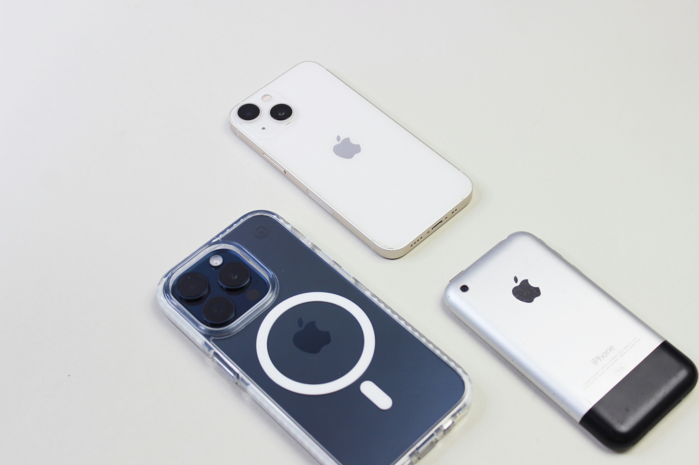

<!--
Think Local: Magic at your fingertips · NextApp DevCon Swift · 45 minutes
Slide plan:
  1   Cover
  2-4 Intro: who I am, ElevenLabs
  5-13 Historical inspiration (same arc as 5-min deck)
  14  Chapter IV: Under the hood (ML demystified)
  15-21 ML fundamentals (intuitive, non-mathy)
  22  Chapter V: iOS
  23-32 iOS platform deep dive (filled from subagent findings)
  33  Chapter VI: The frontier
  34-36 Security close
  37  Blank page
  38  Thank you
-->


<style>

section {
  background: #FFFFFF;
  color: #111111;
  font-family: "Roboto", -apple-system, "Helvetica Neue", Arial, sans-serif;
  font-size: 28px;
  line-height: 1.4;
  padding: 60px 60px 100px 60px;
  position: relative;
}

h1 {
  font-size: 66px;
  line-height: 1.05;
  font-weight: 800;
  letter-spacing: -1px;
  margin: 0 0 24px 0;
  color: #111111;
}

h2 {
  font-size: 34px;
  line-height: 1.2;
  font-weight: 700;
  margin: 0 0 16px 0;
  color: #111111;
}

h3 {
  font-size: 24px;
  line-height: 1.3;
  font-weight: 700;
  margin: 0 0 8px 0;
  color: #111111;
  letter-spacing: 0.5px;
  text-transform: uppercase;
}

p {
  margin: 14px 0 0 0;
  color: #333333;
  max-width: 30ch;
}

strong { font-weight: 700; color: #000000; }
em { font-style: italic; color: #555555; }

code {
  font-family: "SF Mono", "Menlo", monospace;
  font-size: 0.85em;
  background: #F2F2F2;
  padding: 2px 8px;
  border-radius: 4px;
  color: #111;
}

pre {
  background: #F2F2F2;
  padding: 20px;
  border-radius: 8px;
  font-size: 20px;
  line-height: 1.4;
  overflow-x: auto;
}

pre code {
  background: transparent;
  padding: 0;
}

section::before {
  content: "";
  position: absolute;
  left: 60px;
  bottom: 34px;
  font-weight: 800;
  font-size: 20px;
  letter-spacing: -0.5px;
  color: #111111;
  z-index: 10;
}

section.cover::before,
section.company::before,
section.close::before {
  content: "IIElevenLabs";
}

header, footer {
  color: #9A9A9A;
  font-size: 12px;
  font-weight: 700;
  letter-spacing: 1.5px;
  text-align: center;
  width: 100%;
  bottom: 40px;
}

section::after {
  color: #9A9A9A;
  font-size: 14px;
  font-weight: 500;
  right: 60px;
  bottom: 34px;
}

.label {
  position: absolute;
  top: 40px;
  left: 60px;
  font-size: 13px;
  font-weight: 700;
  letter-spacing: 1.8px;
  color: #9A9A9A;
  text-transform: uppercase;
}

section.cover {
  padding: 60px 60px;
  background-image: url('assets/waves/image7.jpg');
  background-repeat: no-repeat;
  background-position: center 55%;
  background-size: 110% auto;
}

section.cover h1 {
  font-size: 130px;
  line-height: 0.95;
  letter-spacing: -3px;
  margin-top: 0;
  max-width: 12ch;
  position: relative;
  z-index: 2;
}

section.cover .subtitle {
  position: absolute;
  left: 60px;
  bottom: 90px;
  font-size: 18px;
  color: #555555;
  font-weight: 500;
  line-height: 1.5;
  max-width: none;
  z-index: 2;
}

section.cover::before {
  color: #111111;
  font-size: 24px;
  z-index: 3;
}

section.story { padding: 60px 60px 100px 60px; }

section.story .kicker {
  position: absolute;
  top: 40px;
  left: 60px;
  font-size: 13px;
  font-weight: 800;
  letter-spacing: 2px;
  color: #9A9A9A;
  text-transform: uppercase;
}

section.story h1 { margin-top: 60px; font-size: 58px; max-width: 15ch; }

section.story .body {
  margin-top: 20px;
  font-size: 22px;
  line-height: 1.5;
  color: #333333;
  max-width: 42ch;
}

section.story .art {
  position: absolute;
  right: 0;
  top: 0;
  width: 42%;
  height: 100%;
  object-fit: cover;
  object-position: center;
}

section.big { padding: 80px 60px 120px 60px; }

section.big h1 {
  font-size: 96px;
  line-height: 1.05;
  letter-spacing: -2px;
  margin-top: 25vh;
  max-width: 100%;
}

section.big .sub {
  font-size: 22px;
  color: #666;
  margin-top: 40px;
  font-weight: 500;
  letter-spacing: 3px;
  text-transform: uppercase;
}

section.now {
  background-image: url('assets/waves/image3.jpg');
  background-repeat: no-repeat;
  background-position: center bottom;
  background-size: 100% 45%;
}

section.now h1 { font-size: 62px; max-width: 14ch; margin-top: 40px; position: relative; z-index: 2; }
section.now .body { margin-top: 24px; font-size: 22px; line-height: 1.5; max-width: 40ch; position: relative; z-index: 2; }

section.chapter {
  display: flex;
  flex-direction: column;
  justify-content: center;
  padding: 60px 60px 100px 60px;
}

section.chapter .num {
  font-size: 16px;
  font-weight: 800;
  letter-spacing: 3px;
  text-transform: uppercase;
  color: #9A9A9A;
  margin: 0 0 12px 0;
}

section.chapter h1 {
  font-size: 140px;
  line-height: 1;
  letter-spacing: -3px;
  margin: 0;
  color: #111111;
}

section.subchapter {
  display: flex;
  flex-direction: column;
  justify-content: center;
  padding: 60px 60px 100px 60px;
}

section.subchapter .num {
  font-size: 14px;
  font-weight: 700;
  letter-spacing: 2.5px;
  text-transform: uppercase;
  color: #9A9A9A;
  margin: 0 0 10px 0;
}

section.subchapter h1 {
  font-size: 80px;
  line-height: 1;
  letter-spacing: -2px;
  margin: 0;
  color: #111111;
}

section.blank { background: #FFFFFF; }
section.blank::before, section.blank::after { content: ""; }

section.blank .caption {
  position: absolute;
  left: 0;
  right: 0;
  bottom: 40px;
  text-align: center;
  color: #B8B8B8;
  font-size: 13px;
  font-weight: 500;
  letter-spacing: 1.5px;
}

section.close h1 {
  font-size: 88px;
  line-height: 1.02;
  letter-spacing: -2px;
  margin-top: 30vh;
  max-width: 16ch;
}

section.close .cta { margin-top: 30px; font-size: 22px; color: #333; max-width: none; }
section.close .link { margin-top: 8px; font-size: 20px; font-weight: 700; color: #111; }

section.close {
  background-image: url('assets/waves/image4.jpg');
  background-repeat: no-repeat;
  background-position: center top;
  background-size: 100% 45%;
  padding-top: 48vh;
}

section.close h2 {
  font-size: 64px;
  line-height: 1.05;
  letter-spacing: -1.5px;
  color: #111;
  margin: 0 0 16px 0;
}

section.close > * { position: relative; z-index: 2; }

section.cover header, section.cover footer { display: none !important; }
section.blank header, section.blank footer { display: none !important; }

.footnotes {
  font-size: 12px;
  color: #999;
  margin-top: 40px;
}

section.close .footnotes {
  position: absolute;
  left: 220px;
  right: 220px;
  bottom: 34px;
  margin: 0;
  text-align: center;
  font-size: 11px;
  line-height: 1.4;
}

section.demo {
  display: flex;
  flex-direction: column;
  justify-content: center;
  padding: 60px 60px 100px 60px;
  background: #050505;
  color: #FFFFFF;
}

section.demo::before, section.demo::after { content: ""; }
section.demo header, section.demo footer { display: none !important; }

section.demo h1 {
  font-size: 180px;
  line-height: 0.95;
  letter-spacing: -4px;
  margin: 0 0 32px 0;
  color: #FFFFFF;
}

section.demo .cue {
  font-size: 22px;
  color: #AAA;
  letter-spacing: 2px;
  text-transform: uppercase;
  font-weight: 700;
  margin-top: 24px;
}

section.demo .hints {
  position: absolute;
  bottom: 60px;
  right: 60px;
  text-align: right;
  font-size: 16px;
  color: #666;
  letter-spacing: 1px;
  line-height: 1.6;
}

section.demo .credit {
  margin-top: 24px;
  font-size: 16px;
  color: #777;
  letter-spacing: 1px;
  font-weight: 500;
  line-height: 1.5;
}

section.demo .credit strong {
  color: #BBB;
  font-weight: 700;
}

section.anim {
  padding: 0;
  background: #FFFFFF;
  overflow: hidden;
}

section.anim iframe {
  width: 100%;
  height: 100%;
  border: 0;
  display: block;
}

section.anim::before, section.anim::after { content: ""; }
section.anim header, section.anim footer { display: none !important; }

.two-col {
  display: grid;
  grid-template-columns: 1fr 1fr;
  gap: 40px;
  margin-top: 30px;
}

.two-col > div h3 { color: #111; }
.two-col p { font-size: 20px; max-width: none; margin-top: 8px; }

</style>

<!-- _class: cover -->
<!-- _paginate: false -->

# Think Local

<div class="subtitle">
Magic at your fingertips<br>
Michael Gerasymenko · ElevenLabs<br>
NextApp DevCon Swift · 2026
</div>

<!--
Hey everyone. My name is Michael Gerasymenko. Thanks for having me.

Next forty-five minutes: on-device AI. What it is, what runs today, what breaks, where it goes.

I'll start with some history. Then we go under the hood: what a model actually is, how the Apple stack handles it. Then the walls I hit shipping on iOS. We close on the frontier.

Hold questions for the end. Or catch me in the hallway. Or on LinkedIn.
-->

---

# Who am I

- Building mobile apps since **2009**
- iOS everywhere: Readdle, Wire, CaraCare, Feeld, now ElevenLabs
- Author of **XcodeSelectiveTesting**
- Blog: [gera.cx](https://gera.cx)

<!--
Building iOS since 2009, when the SDK first dropped. Readdle, Wire, CaraCare, Feeld, now ElevenLabs. Also maintain an open-source tool, XcodeSelectiveTesting, for test optimisation.

Point being: when I talk about mobile shifts later, I watched them happen.
-->

---

<!-- _class: company -->

<div class="label">ELEVENLABS / CONTEXT</div>

# ElevenLabs

- The Voice AI · over $600M ARR · valued at $22B
- Started here six months ago, company went 400 → 800 people
- I'm on the Mobile team, working on **ElevenReader**
- We're hiring, also remote
- *Opinions are my own*

<!--
I work at ElevenLabs. The voice AI company. Our CEO Mati keeps saying voice will be the interface for AI, and the numbers back it up.

Joined six months ago. We doubled headcount in that time. Mobile team is hiring, remote is fine.

I work on ElevenReader. If you want to see what the research team ships, that's the app. Catch me after and I can set you up with a free annual subscription. Small catch: tell me about any bugs.

Opinions here are my own.
-->

---

<!-- _class: chapter -->

<div class="num">Part One</div>

# The Pattern

<!--
Three short historical stories. They are the whole reason I think on-device AI matters.
-->

---

<!-- _class: chapter -->

<div class="num">Chapter I</div>

# Time

---

<!-- _class: story -->

<div class="kicker">BEFORE / Chapter I</div>

# Precise time


<!--
We complain about not having enough time. People in the past had a worse problem. They couldn't tell what time it was.

Medieval European town. The biggest building has a huge clock on it. Bells ring at specific hours. Someone walks door to door to wake people up. Time was infrastructure. You looked up at the tower. If you couldn't see it, you didn't know.

Peasant, merchant, scholar. None of them had a way to privately know the exact time.
-->

---

<!-- _class: story -->

<div class="kicker">BEFORE / Chapter I</div>

# Sailors got lost at sea


<!--
1714. The British Empire is losing ships. Storms were not the reason. Enemies were not the reason. Sailors could not tell where they were.

To know your longitude at sea, you need the exact time back at your home port. No clock on earth survived an ocean voyage. Temperature, humidity, pitch and roll broke them all.

Parliament offers twenty thousand pounds. Millions in today's money. To anyone who can build one.
-->

---

<!-- _class: story -->

<div class="kicker">AFTER / Chapter I</div>

# Time moved onto your wrist


<!--
John Harrison spent forty years building a chronometer that worked at sea. A century later, wristwatches were cheap for everyone.

If you asked a medieval peasant to imagine the future of time, they would have described a bigger clock tower. Maybe one with lights. They would never have imagined a personal pocket watch.

The centralised source was what they knew.
-->

---

<!-- _class: chapter -->

<div class="num">Chapter II</div>

# Computer Time

---

<!-- _class: story -->

<div class="kicker">BEFORE / Chapter II</div>

# You walked to the computer


<!--
My mother, in the 1970s, wrote her university assignments on punch cards. Walked to the university basement. Handed them to an operator. The task ran overnight. She came back the next day. Sometimes to find a single letter wrong.

Computing lived in a room. You visited it.

Same shape as the town clock.
-->

---

<!-- _class: story -->

<div class="kicker">AFTER / Chapter II</div>

# The computer walked into your pocket



<!--
Then it moved. First onto desks. Then into pockets. I started building for iPhone in 2009.

When Steve Jobs held up that phone in 2007, nobody in that room predicted a billion-dollar photo filter app. Nobody predicted summoning strangers' cars. Nobody predicted replacing SMS with a chat app.

Those products appeared because the technology moved to the person. Social patterns died too. Waiting by the landline for a call you could not miss has evaporated for anyone under twenty-five.
-->

---

<!-- _class: chapter -->

<div class="num">Chapter III</div>

# Next Revolution

---

<!-- _class: big -->

<div class="label">THE PATTERN</div>

<h1>It happens again. <br> It happens faster.</h1>

<!--
Four hundred years for clocks. Fifty years for factory power. Twenty for computers. Fifteen for mobile.

Every wave is faster. Every wave, we underestimated what people would do with the capability once it was personal and private, instead of centralised.
-->

---

<!-- _class: now -->

<div class="label">RIGHT NOW</div>

# We rent thinking by the token

<div class="body">
Today, if you want to think with AI, you send your data to someone else's building and pay for the round trip.

<strong>This is the last decade you'll do that.</strong>
</div>

<!--
Which brings us to right now. If you want to think with AI, you send your prompt to a data centre in Virginia or Oregon, and you pay for the round trip by the token. Your users' voices. Your customers' medical records. Your own ideas.

Soon, "wait, you had to send your data to a server?" will sound as antique as "wait, you had to be home to receive a phone call?"

The technology will move. Physics, economics, privacy all point the same way. That shift is inevitable.
-->

---

<!-- _class: chapter -->

<div class="num">Part Two</div>

# Under the Hood

<!--
OK. On-device AI is coming. What does that actually mean? What is a model that we're running? Why does it need compiling? Why is Apple's stack different from everyone else's?

Next ten minutes, I'll demystify it. I'm not teaching you ML. Just enough mental model that when someone throws words at you (quantization, NPU, fp16), you have intuition for what they mean.
-->

---

# A model is a function

```
function model(input: [float]) -> [float] {
    // billions of multiplications later
    return output
}
```

<!--
Start here. A machine learning model is a function. Takes an array of numbers in. Returns an array of numbers out.

That is it. No magic.

Text-to-speech: input encodes the text, output encodes a waveform. Image classifier: input is pixels, output is "this is seventy-three percent a cat."

The entire intelligence of the model lives in the numbers it uses to transform input into output. Those numbers are called weights.
-->

---

<!-- _class: anim -->

<iframe src="assets/anim/matmul.html"></iframe>

<!--
Here is what one of those multiplications looks like. One row of the weight matrix, dot-producted with the input vector, lights up one cell of the output. Repeat for each row. That is one layer.

A modern model does billions of these every second.
-->

---

# Weights are the model

- Billions of numbers in a specific layout
- Stored as **floats** (fp32, fp16, bf16) or **ints** (int8, int4)
- A file. Usually hundreds of MB to several GB.
- *This is what you ship to the device.*

<!--
When we say "ship the model to the device," we mean ship a file with those billions of numbers in it.

They can be stored at different precisions. Thirty-two-bit floats are accurate and huge. Half-precision cuts the size in half with usually imperceptible quality loss. Quantization squeezes further, to eight-bit integers or smaller. Much smaller file, much faster, usually some quality cost.

A model that is two gigabytes in fp32 might be five hundred megabytes in fp16, one hundred and fifty quantized. Often the difference between "this fits in your app" and "this doesn't."
-->

---

<!-- _class: anim -->

<iframe src="assets/anim/weights-vs-activations.html"></iframe>

<!--
Mental model to keep. The grey grids are weights. They load once at session start and stay in memory. The red pulses are activations, the data flowing through the network on each inference. New data in, new data out, same weights the whole time.

Loading weights is a one-time cost. Running activations through them is what happens every time a user asks something.
-->

---

# Hardware does the math

<div class="two-col">
<div>
<h3>CPU</h3>
<p>General-purpose. SIMD (NEON on every ARM, AMX on Apple) for parallel math.</p>
</div>
<div>
<h3>GPU</h3>
<p>Thousands of small cores. Metal on Apple, Vulkan on Android. Great for big tensors.</p>
</div>
</div>

<div class="two-col">
<div>
<h3>NPU</h3>
<p>Fixed-function silicon. Apple ANE, Qualcomm Hexagon, Samsung ENN, Google Tensor. Fastest and most efficient.</p>
</div>
<div>
<h3>The tradeoff</h3>
<p>Each tier is faster but more constrained in what it can run.</p>
</div>
</div>

<!--
Three places math can happen on a modern phone. CPU, GPU, NPU.

CPU has SIMD instructions. NEON on every ARM chip. AMX on recent Apple ones. Many multiplications per cycle. Flexible, general.

GPU has thousands of small cores that multiply in parallel. Great for big tensor operations. Metal on Apple, Vulkan on Android.

NPU is purpose-built silicon for ML ops. Apple calls theirs the Neural Engine. Qualcomm has the Hexagon DSP. Samsung has ENN. Google has their Tensor Edge TPU. Each one has its own instruction set.

Fastest and most energy-efficient. Also the most constrained. If your model has a weird layer the NPU cannot run, the runtime falls back to GPU or CPU.
-->

---

<!-- _class: anim -->

<iframe src="assets/anim/hardware-compare.html"></iframe>

<!--
Same matrix operation on each of the three. CPU takes the longest, uses the most power. GPU is faster, uses less. NPU is fastest, uses the least. The tradeoff sits on the NPU side. It only accepts certain op shapes. An unsupported layer and it bounces back to GPU or CPU.
-->

---

# Compilation makes the model fit the hardware

- Model file arrives in a **portable format** (ONNX, Core ML Package)
- First time you load it: runtime **compiles** it for *this specific chip*
- Takes seconds to minutes
- Cached per device, per OS version

<!--
This trips people up. The model file you ship is portable, same bytes on every iPhone. But the operations in that model have to become actual GPU shaders or ANE instructions on the chip you are running on. That translation is called compilation.

It happens the first time the model loads on a device. Recent iPhone, a few seconds. Older iPhone, thirty seconds. The compiled result is cached, so subsequent launches skip it.

This is why on-device models often have a visible "preparing" moment the first time. We will come back to this.
-->

---

<!-- _class: anim -->

<iframe src="assets/anim/fragmentation.html"></iframe>

<!--
One source model, four target formats, four pieces of silicon. Each conversion is non-trivial. Each target has its own op coverage, its own quantization support, its own debugging tools. This is what "fragmentation" actually looks like.
-->

---

# Why one model file won't run everywhere

- Apple ANE ≠ Qualcomm Hexagon ≠ Mediatek APU ≠ Google Tensor ≠ Samsung ENN
- Each needs the model **compiled for it**
- Different formats: `.mlpackage`, `.aimodel`, `.tflite`, `.pte`, `.onnx`
- Different quantization support
- Different op coverage

<!--
Critical point. The compiled model for an iPhone is nothing like the compiled model for an Android phone.

Apple's Neural Engine, Qualcomm's Hexagon DSP, MediaTek's APU, Google's Tensor. Each has its own instruction set, its own op coverage, its own quirks. The shippable artefact is usually a model in a portable format that gets re-compiled on each device at install or first launch.

Some chipset vendors offer their own SDK with pre-compiled models. Others expect you to use a cross-platform runtime. There is no "one model binary everywhere." That fragmentation is one of the real costs of on-device AI.
-->

---

<!-- _class: demo -->

# Live.

<div class="cue">On-device · airplane mode · my phone</div>

<div class="credit"><strong>Model:</strong> ElevenLabs Research team · <strong>Integration:</strong> Michael Gerasymenko</div>

<div class="hints">
Pre-warm backstage.<br>
Airplane mode toggle visible.<br>
Audio through the venue PA.<br>
Backup video on next slide.
</div>

<!--
[Walk to the device. Pause.]

Everything we just talked about, running on this phone. Airplane mode is on. No network. No cloud. Watch.

[Trigger synthesis. Thirty to sixty seconds. Let it speak for itself.]

That is what we are here to talk about.

STAGE NOTES:
- Device: A19 or newer only (iPhone 17 Pro, 18 Pro). Older chips risk minutes-long cold compile.
- Pre-warm backstage: load the model, run two or three full synthesis cycles, confirm cache hit, then background the app.
- Airplane mode toggle in front of the audience. Status bar must be visible on the mirrored screen.
- Audio through the venue PA. Confirm during AV check.
- Second iPhone in the bag as hardware backup, same pre-warm done.
- If both devices fail, press space. The next slide is the pre-recorded backup video.
- If skipping entirely: say "I would love to demo this live but I can show you the recording instead" and advance to the next slide.
-->

---

<!-- _class: demo -->

# Backup

<div class="cue">Pre-recorded · same device · same airplane mode</div>

<!--
[Only reached if live demo fails or is skipped. Pre-recorded video of a working synthesis session. Narrate what the audience is seeing.]

Same device, same airplane mode, recorded last week. The research app running the TTS pipeline on-device.

[Placeholder: embed pre-recorded demo video file here before the talk. Keep the file as both an embedded resource and a desktop fallback.]
-->

---

<!-- _class: chapter -->

<div class="num">Part Three</div>

# iOS

<!--
The fun part. What this looks like when you build it for iOS.

Six months at ElevenLabs on this. I'll share what we learned.

Disclaimer. Our model internals stay inside the company. The integration story is fair game. The stack, the pipeline, the pitfalls. All the engineering around the model.
-->

---

<div class="label">VOCABULARY · SKIP IF COMFORTABLE</div>

# Terms you'll hear

<div class="two-col">
<div>
<h3>ANE</h3>
<p>Apple Neural Engine. Fixed-function ML silicon.</p>
</div>
<div>
<h3>Core ML</h3>
<p>Apple's ML runtime since iOS 11. Model format: <code>.mlpackage</code>.</p>
</div>
</div>

<div class="two-col">
<div>
<h3>Core AI</h3>
<p>New in iOS 27. Replaces Core ML for LLM-scale workloads. Model format: <code>.aimodel</code>.</p>
</div>
<div>
<h3>MLX</h3>
<p>Apple's PyTorch-like array framework. Research-first, Mac-shipping.</p>
</div>
</div>

<!--
Thirty-second anchor for anyone who has not shipped on this stack before. Four terms will come up constantly. Here they are. Skip ahead mentally if you know them.
-->

---

<div class="label">THE APPLE STACK</div>

# What Apple gives you

<div class="two-col">
<div>
<h3>Core ML</h3>
<p>The default runtime. Dispatches to ANE / GPU / CPU automatically. <code>.mlpackage</code> format.</p>
</div>
<div>
<h3>Metal Performance Shaders</h3>
<p>Lower-level GPU compute. <code>MPSGraph</code> for custom ops.</p>
</div>
</div>

<div class="two-col">
<div>
<h3>MLX</h3>
<p>Apple's new array framework. PyTorch-like. Research-friendly. Shipping-friendly.</p>
</div>
<div>
<h3>Foundation Models (26)</h3>
<p>On-device LLM with a Swift API. Apple's own model. Not for your weights.</p>
</div>
</div>

<!--
Apple gives you a stack of options.

Core ML is the default. You convert your model to a dot mlpackage, drop it in your bundle, call MLModel to load, call prediction to run. Dispatches to Neural Engine, GPU, or CPU automatically. Ninety percent of what you want.

Metal Performance Shaders sits one layer down. Reach for it if you need a custom op or something hybrid.

MLX is Apple's newer research framework. PyTorch-like, open source, runs on CPU and GPU on Apple Silicon. Increasingly a reasonable production target for things that don't convert cleanly to Core ML.

Foundation Models arrived at WWDC. Apple's own on-device LLM with a Swift-first API. You cannot put your own weights in it. But if you want text completion, summarisation, classification on recent Apple hardware, you don't ship a model at all. Apple ships one with the OS.
-->

---

<div class="label">OUR PIPELINE</div>

# Three runtimes, one app

<div class="two-col">
<div>
<h3>Core ML</h3>
<p>Default. iOS 17+. CPU/GPU/ANE dispatch. Mature kernels.</p>
</div>
<div>
<h3>Core AI</h3>
<p>New. iOS 27+. Palettization, better memory control. Still maturing.</p>
</div>
</div>

<div class="two-col">
<div>
<h3>MLX</h3>
<p>Research-first. We use it on Mac; iOS still ahead.</p>
</div>
<div>
<h3>Reality</h3>
<p>Production uses <strong>all three in the same pipeline</strong>, per sub-model.</p>
</div>
</div>

<!--
This one surprised me most. You don't pick a runtime for your app. You pick one per sub-model.

Our pipeline uses Core ML for some pieces, on CPU, and Core AI for others on the Neural Engine. The choice comes from benchmarks. Whatever is fastest on the target hardware for that specific graph wins.
-->

---

<!-- _class: subchapter -->

<div class="num">iOS · beat two</div>

# Dispatch

<!--
Now the dispatch question. You asked for the ANE. Did you get it?
-->

---

<div class="label">PLACEMENT</div>

# `.cpuAndNeuralEngine` is only a hint

- You request a compute unit
- Core ML / Core AI runs its own cost model over the whole graph
- Decides: ANE, GPU, or CPU
- **On A16, we asked for Neural Engine and got CPU.**
- On another model, we asked for Neural Engine and got Metal.

<!--
If you remember one thing from this talk. When you set computeUnits to cpuAndNeuralEngine, you are offering the system a budget. The system then runs its own cost model across the whole graph and picks whatever it thinks is best. That might be the ANE. That might be CPU.

On the iPhone 15, the A16 chip, we repeatedly saw Core ML's int8 CPU path beat Core AI's palettized GPU path for our workload. Eight years of hand-tuned NEON and AMX kernels is a hard baseline to clear.

So "did the ANE run my model" is a question you answer with Instruments. There is no code API that tells you. There is no "why wasn't my op on ANE" tool either, as of the iOS 27 beta. I asked. Apple folks in the room, this is my ask.
-->

---

<div class="label">SHAPES</div>

# Tensor shapes: static vs dynamic

A tensor "shape" is its dimensions. Something like `[1, 128, 512]`.

<div class="two-col">
<div>
<h3>Static shape</h3>
<p>All dimensions known at compile time. Memory layout is fixed.</p>
</div>
<div>
<h3>Dynamic shape</h3>
<p>One or more dimensions decided at runtime. Flexible, costly.</p>
</div>
</div>

<p style="margin-top: 30px; max-width: 60ch;">GPUs and NPUs plan memory and shaders ahead of time. They prefer static.</p>

<!--
Before the trap, one concept. A tensor is a multi-dimensional array. Its shape is its dimensions. Something like one by one hundred and twenty-eight by five hundred and twelve.

Static shape: every dimension known when the model compiles. Dynamic shape: at least one dimension decided at runtime, when the actual input arrives.

Hardware accelerators plan memory layout and shader programs ahead of time, based on the shapes they expect. Shapes change, they replan.
-->

---

<!-- _class: anim -->

<iframe src="assets/anim/static-vs-dynamic.html"></iframe>

<!--
Both rows run ten inferences. Top row has a static shape. The model compiles once, every inference is cheap. Bottom row has a dynamic shape. Every new input triggers a recompile. Static finishes while dynamic is still working.
-->

---

<div class="label">DYNAMIC SHAPES</div>

# Dynamic shapes punish you twice

- First time with a new shape: 5 to 20 seconds of recompilation on A16
- Over time: 32 residency set ceiling on the A16 GPU, one slot per unique shape
- Hit 33, start evicting
- Fix: pad inputs to a small set of fixed buckets

<!--
Dynamic shapes feel innocent in Python. On device they are brutal.

Every time a new input shape hits the graph, Core AI recompiles. On A16 that is five to twenty seconds. Unusable inside a UX loop.

Second problem. The Apple GPU has a hard ceiling of thirty-two Metal residency sets. Each unique shape consumes one. Hit thirty-three, start evicting.

The fix: do not let shapes vary. Pad everything to a small set of fixed bucket sizes. You waste compute on the padding. Still the right call.
-->

---

<!-- _class: subchapter -->

<div class="num">iOS · beat three</div>

# Runtime

<!--
And the runtime chapter. What happens when the thing actually runs.
-->

---

<div class="label">FIRST LAUNCH</div>

# Cold compile is a UX event

- First Core AI specialization for a fused ANE graph:
  - **~60 s on A19** (iPhone 17 Pro)
  - **Several minutes on A16** (iPhone 15)
- Cached per device, per OS version
- *Users see "preparing..." the first time. Always.*

<!--
This one will show up in your support tickets.

The first time a model loads on a device, the runtime compiles it to native code for that chip. Simple classifier, fast. Serious pipeline with multiple pieces, less so.

On an iPhone 17 Pro we saw about sixty seconds for one of our pipelines. On an iPhone 15, several minutes. Older devices, worse.

The compiled artefact caches. Subsequent launches skip the compile. The first time, you need UI. "Preparing." Make it a feature. Warm up in the background when network is fine and the app is unlikely to be killed.

Long-term fix is ahead-of-time compilation during the app build. Apple ships coreai-build compile for this. We are not there yet in our ship pipeline.
-->

---

<div class="label">MEMORY</div>

# Peak memory is where you die

- Loading a hybrid pipeline + fallback can hit **~1.4 GB** on iPhone 15
- One variant was retired after OOMing at a **3 GB** watermark during specialization
- Low-RAM devices (≤4.5 GB): split sub-models across CPU and ANE
- Memory-warning observer is wired. We *don't* unload mid-session.

<!--
Memory kills more models than latency does.

iPhone 15 is a six-gigabyte device. Our hybrid pipeline plus a Core ML fallback peaks around 1.4 gigabytes during setup. One Core AI variant we tried OOMed at a three-gigabyte watermark during specialisation. We retired it.

On devices with 4.5 gigs of RAM or less, we automatically route some pieces to CPU only, to bound the ANE residency footprint. Different placement, worse latency, lower memory.

We hook memory warnings. We do not unload mid-session. Reloading mid-conversation is worse than the pressure. Pick your poison.
-->

---

<div class="label">INTEGRATION</div>

# Swift concurrency around ML

```swift
@MainActor @Observable
final class CoreMLTTSManager { ... }

nonisolated func synthesize(_ text: String) async throws -> AudioStream
```

- Inference is `nonisolated async throws`
- Internal engine is `@unchecked Sendable` with init-time static config
- *Cancellation plumbing is weak. Plan it in from the start.*

<!--
On the Swift side. The manager is MainActor Observable, for UI binding. Inference is nonisolated async throws, so it doesn't block the main actor.

We mark the internal engine unchecked Sendable, with configuration that is write-once at init, read-only during inference. The pragmatic path.

Cancellation is the weakest part of our setup. MLModel's prediction call does not take a cancellation token. If you want to cancel mid-synthesis, split the pipeline into cancellable chunks. Plan it in from the start.
-->

---

<div class="label">PERF HYGIENE</div>

# Three things that silently cost you 30%

- **Debug builds.** Core AI inference is ~1.3× slower in Debug
- **File I/O in the hot path.** ~30% throughput loss from diagnostic file writes
- **A `minV/maxV/meanV` loop** left in a hot path caused a 2× slowdown

<!--
These are embarrassing but universal.

Always benchmark Release. Debug is about one-point-three times slower for Core AI inference, and you will chase phantom regressions.

Never do file I/O in the hot path. We had diagnostic file writes, thirty-nine per synthesis, costing thirty percent throughput. Removed them, took it right back.

Discipline one. If you add a debug min, max, mean loop over the output tensor to sanity-check, remember to remove it. Mine cost us a two times slowdown for a week.
-->

---

<div class="label">iOS VERSIONS</div>

# Version gates to know

- **iOS 17+** · Core ML `.load(contentsOf:configuration:)` API
- **iOS 27+** · Core AI framework entirely
- **A14 minimum** for on-device TTS (practical floor)
- **A16 vs A19:** same request, radically different timings
- Fence with `#if canImport(CoreAI)` and `@available(iOS 27.0, *)`

<!--
Final platform note. Core AI landed in iOS 27. If you want to ship on earlier versions, you need Core ML. We ship both, selected at runtime.

Hardware floor is practically A14 for anything the size of a serious model. Below that, memory and compute do not earn their keep.

Something I did not expect. The Core AI Swift API changed between iOS 27 betas. NDArray MutableView baseAddress moved to withUnsafeMutablePointer. AsyncValue ndArray became try await. Fence everything with canImport CoreAI, or your build breaks on the next Xcode update.
-->

---

<!-- _class: chapter -->

<div class="num">Part Four</div>

# The Frontier

<!--
We have covered the inevitable: technology moving to the device. We have covered the engineering reality: how the stack actually works on iOS. I want to end on what is still unsolved, because that is where the next few years of this field will be fought.
-->

---

<!-- _class: anim -->

<iframe src="assets/anim/path-to-gpt4.html#1"></iframe>

<!--
Before we close, the shape of the next few years. Four pieces to the puzzle.

Piece one: compute. Doubling about every two years. The dual-NPU iPhone 18 Pro roughly doubles the A19. Snapdragon on the same curve.
-->

---

<!-- _class: anim -->

<iframe src="assets/anim/path-to-gpt4.html#2"></iframe>

<!--
Piece two: memory bandwidth. The harder constraint for LLM inference. Jumped seventy percent on Apple in one generation. Snapdragon close behind.
-->

---

<!-- _class: anim -->

<iframe src="assets/anim/path-to-gpt4.html#3"></iframe>

<!--
Piece three: software. Four model-side techniques compound. Int4 quantization. Mixture of experts. Partial loading from flash. Distillation. Each multiplies effective capacity on the same hardware.
-->

---

<!-- _class: anim -->

<iframe src="assets/anim/path-to-gpt4.html#4"></iframe>

<!--
Stack all of it together. GPT-4 class inference on a flagship phone, in airplane mode, is a 2028 problem. Not a decade away.

Both platforms. Both ecosystems get there within months of each other.
-->

---

# Security is the real blocker

The model file is the asset. A trained model represents millions of dollars of compute, proprietary data, and years of research. Protecting it on an untrusted device is an unsolved problem.

<!--
Six months ago I thought the hard problem was performance. It is not. Performance is a solvable engineering problem. The hard problem is protecting the model from the device it runs on.

For a company whose moat is its model, this is existential. For an open-source model, it does not matter. The gap between those two situations is where the next few years get decided.

[Pause.]
-->

---

<div class="label">THE THREAT MODEL</div>

# What an attacker with a device can do

- Pull the model file out of app storage, over USB or ADB
- Hook the inference call with Frida or LLDB
- Dump decrypted weights from process memory
- Replay or clone the model on their own hardware
- *Encryption at rest does nothing. The model has to decrypt to run.*

<!--
If I ship my weights to your device, I have effectively handed them over. The license fiction doesn't help once the bits are inside your sandbox.

A motivated person can pull the model file out of the app sandbox over USB. They can hook into the running process with Frida or LLDB and watch the weights decrypt into RAM. They can dump memory and reconstruct the file.

Encryption at rest buys you nothing, because the model has to decrypt to run. The decrypted copy exists in RAM for the duration of inference. That is the window.
-->

---

<div class="label">THE PROTECTION LANDSCAPE</div>

# Tools that raise the cost

<div class="two-col">
<div>
<h3>RASP</h3>
<p>Runtime App Self-Protection. Anti-debug, anti-hook, integrity checks. Promon, Guardsquare, Jscrambler.</p>
</div>
<div>
<h3>App Attest</h3>
<p>Apple's attestation. Ties your binary and device identity to a server-issued token.</p>
</div>
</div>

<div class="two-col">
<div>
<h3>FairPlay for Core ML</h3>
<p>Apple's model encryption. Keys delivered by Apple servers. Integrated with Core ML load path.</p>
</div>
<div>
<h3>Secure Enclave</h3>
<p>Hardware key store. Kilobytes of memory. Can hold wrapping keys. Cannot hold the model.</p>
</div>
</div>

<!--
A stack of tools raises the cost of extraction.

RASP vendors sell runtime protection. Anti-debug, anti-hook, integrity checks. A determined attacker still gets through. The point is to make it expensive.

Apple's App Attest attests your binary and device identity to your server, so you can refuse to deliver a model key to a jailbroken or modified client.

FairPlay for Core ML encrypts the model file at rest, with keys delivered through Apple's licensing infrastructure. Clean integration with the Core ML load path.

The Secure Enclave is a hardware key store with kilobytes of memory. Big enough for a wrapping key that unwraps your model key. Nowhere near big enough for the model itself.

Stacked together, this is what a serious on-device deployment looks like today.
-->

---

<div class="label">THE GAP</div>

# What is still missing

- No developer-accessible trusted execution environment large enough for a model
- No hardware memory encryption that excludes a root-level reader on a jailbroken device
- No attested execution that binds (model hash, program hash, device identity) to a third-party key release
- *This is why high-value proprietary models still live in the cloud.*

<!--
Where the stack breaks down is at the last mile. Even with App Attest, FairPlay, Secure Enclave key wrapping, there is a moment during inference when the decrypted weights sit in GPU or NPU memory. A root-level process on a jailbroken device can read that memory.

What would close the gap: an attested trusted execution environment, big enough to hold a model, with hardware memory encryption on the accelerator buffers, and a way to release keys to it only when a known program is running on a known device. None of those exist today in a form developers can use.

This is why ElevenLabs, OpenAI, Anthropic, Google, Meta all keep their best models in the cloud. The compute to run them on-device is here. The protection story around them is still missing.
-->

---

# But open source changes the calculus

- You don't need **your** model on-device
- Hundreds of production-quality open models exist (Llama, Mistral, Whisper, Qwen, Gemma, ...)
- They're safe to ship. The "IP" is public.
- **The product is what you build *around* the model.**

<!--
There is an opening. You do not need your own model on-device to build a great product. Thousands of excellent open-source models exist. Llama, Mistral, Whisper for speech-to-text, Qwen, Gemma. The Chinese labs ship monthly. All safe to deploy, because the weights are already public.

The IP sits in the product you build around the model. The UX. The data layer. The agentic logic. The integration with the rest of the user's device.

That is the design space that opens up when thinking shifts to the edge.
-->

---

<div class="label">WHAT TO TRY MONDAY</div>

# Start somewhere

<div class="two-col">
<div>
<h3>If you have never shipped a model</h3>
<p>Open Foundation Models in iOS 26. One <code>LanguageModelSession</code>, text in, text out. Thirty minutes.</p>
</div>
<div>
<h3>If you want your own weights</h3>
<p>Try MLX Swift with a small open model (SmolLM, Qwen 0.5B). Native Swift, Mac-first.</p>
</div>
</div>

<div class="two-col">
<div>
<h3>If you want to go deep</h3>
<p>Convert a PyTorch model with CoreAI-Torch. Ship an <code>.aimodel</code>. Watch cold-compile with Instruments.</p>
</div>
<div>
<h3>If you want to understand IP</h3>
<p>Read Apple's App Attest docs. Then try to extract a model from your own binary. Humbling.</p>
</div>
</div>

<!--
Four entry points at different depths. Easiest to hardest. Pick the one that matches where you are. The point is to start, not to finish.
-->

---

<!-- _class: blank -->
<!-- _paginate: false -->

<div class="caption">THIS PAGE IS INTENTIONALLY LEFT BLANK</div>

<!--
[Pause.]

The product is a blank page. Your job as iOS engineers is to be among the first to figure out what goes on it.

[Longer pause before advancing.]
-->

---

<!-- _class: close -->

## Thank you

<div class="cta">If this made you think about tomorrow, we're hiring people to figure it out.</div>

<div class="link">elevenlabs.io/careers · gera.cx · come say hi</div>

<div class="footnotes">Some images AI-generated. Thanks to Unsplash users Sophia Stark and Enrico Bet.</div>

<!--
Thank you.

If any of this made you think about tomorrow instead of today, we are hiring iOS people at ElevenLabs. Find me after. Thanks NextApp.
-->
